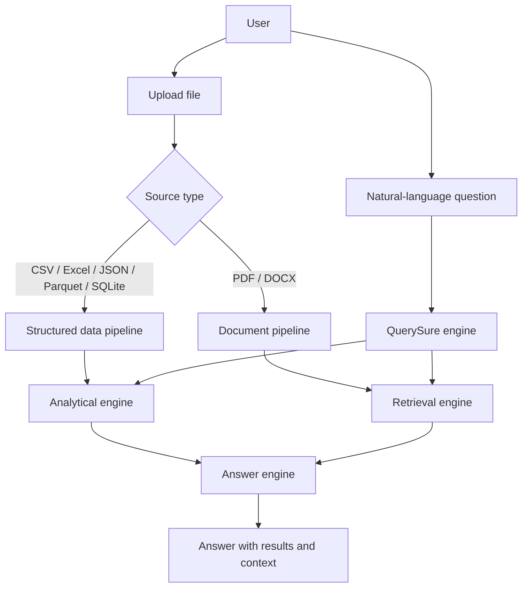
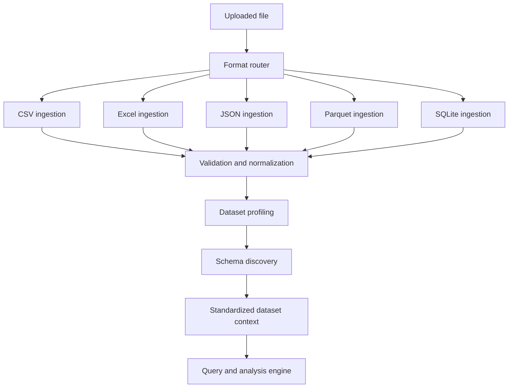
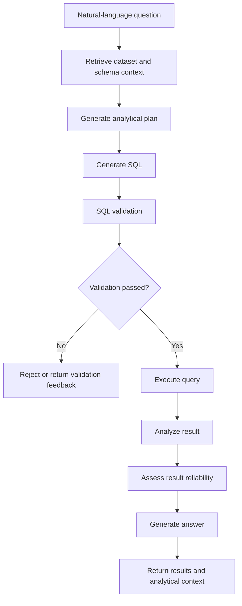
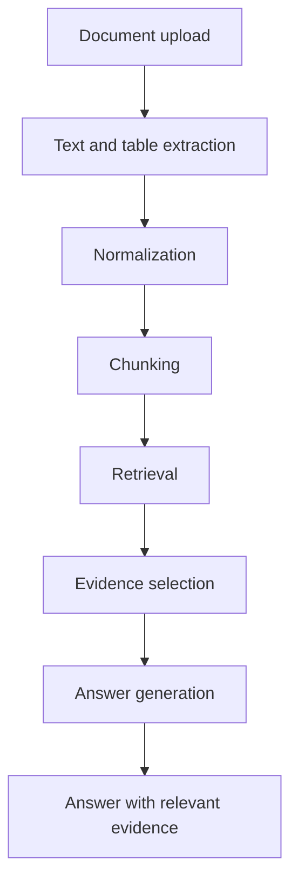
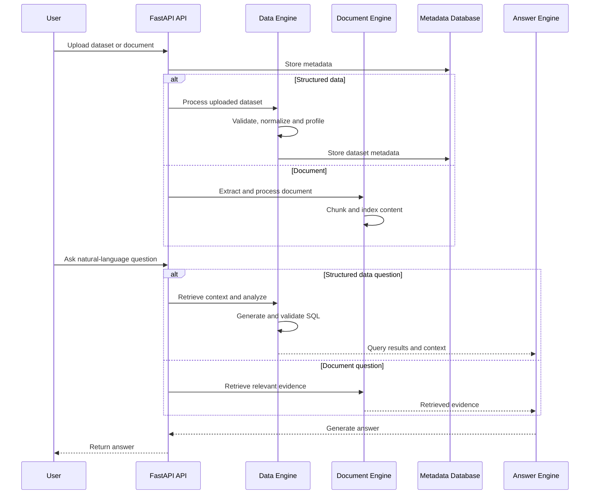
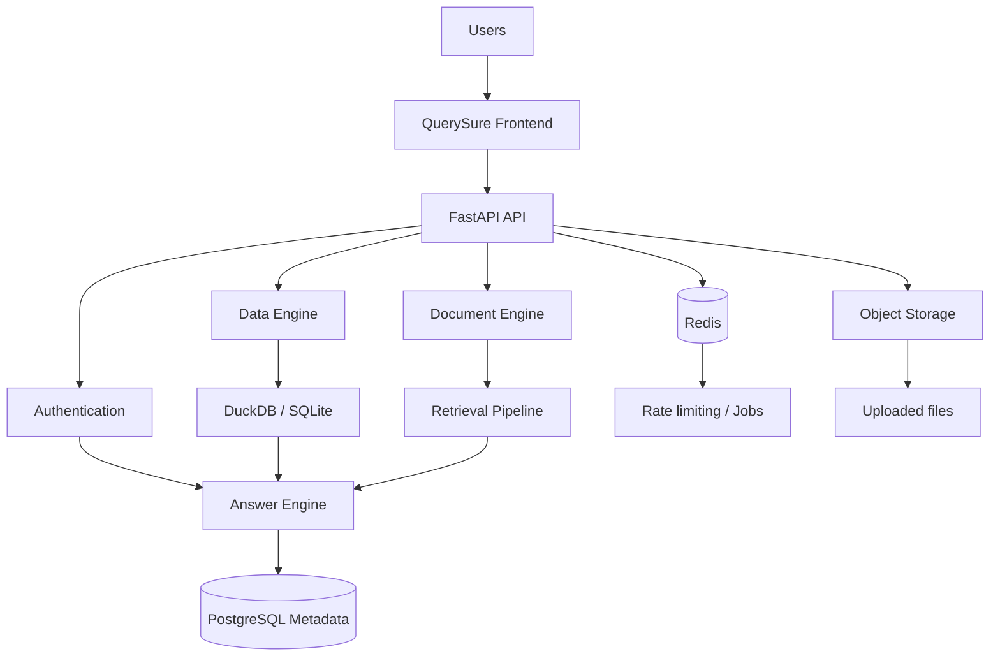

# QuerySure

### Trust-first natural language analytics for structured data and documents

QuerySure is a full-stack analytics system that lets users ask questions about uploaded data in natural language.

The project handles two different kinds of sources:

* **Structured data** such as CSV, Excel, JSON, Parquet, and SQLite
* **Documents** such as PDF and DOCX

These sources do not go through the same pipeline. Structured datasets are profiled and prepared for analytical querying, while documents go through extraction and retrieval. Both paths eventually produce an answer with the relevant analytical context or supporting evidence.

A key part of QuerySure is that generated SQL is **not executed immediately**. Analytical operations pass through validation before execution, and the result can be assessed for reliability before being returned.

> The project started with retail analytics as a primary use case, but the data-processing architecture is not tied to a single retail schema.

---

## What problem does QuerySure solve?

Exploring a new dataset usually requires a combination of tasks:

* Understanding the schema
* Checking data quality
* Identifying relationships between tables
* Writing SQL
* Verifying whether the query is safe
* Interpreting the result

Documents introduce a different problem: finding the relevant information before answering the question.

QuerySure separates these concerns instead of treating every uploaded file as the same type of source.



---

## Demo Visuals 


# Core Capabilities

## Natural-Language Analysis

Users can ask analytical questions without manually writing SQL.

Examples include:

* What were the highest-selling products last quarter?
* Which region generated the most revenue?
* How did revenue change month over month?
* Which customers contributed the highest percentage of sales?
* Show the top five categories by growth.
* Compare this year's performance with last year.

For structured data questions, QuerySure uses dataset context and schema information to determine the required analysis.

---

## Structured Data Support

QuerySure supports:

* CSV
* Excel (`.xlsx`)
* JSON
* Parquet
* SQLite databases

The ingestion flow is format-aware rather than assuming every file can be processed identically.



---

# Dataset Profiling

Before analytical questions are processed, QuerySure builds context about the uploaded dataset.

The profiling layer examines:

* Row and column counts
* Inferred data types
* Missing values
* Unique values
* Duplicate records
* Numeric statistics
* Date ranges
* Potential primary keys
* Data-quality warnings

This gives the analysis layer information about the dataset before analytical operations are generated.

---

# Schema Discovery and Relationship Inference

When a dataset contains multiple tables or sheets, QuerySure examines the available structure to identify potential relationships.

For example:

```text
sales.customer_id
        │
        ▼
customers.customer_id
```

Relationship inference considers:

* Column names
* Data types
* Uniqueness
* Value overlap
* Existing database foreign keys

Relationships are associated with confidence information rather than assuming that two similarly named columns are automatically related.

This is important when working with uploaded data because schemas may be incomplete, inconsistent, or lack explicitly defined foreign keys.

---

# Query Intelligence

Depending on the user's question, QuerySure can work with analytical operations such as:

* Filtering
* Aggregation
* Grouping
* Sorting
* Joins
* CTEs
* Subqueries
* Conditional logic
* Date-based analysis
* Rankings
* Percentages and ratios
* Growth analysis
* Month-over-month comparisons
* Year-over-year comparisons
* Running totals
* Moving averages
* Trend analysis
* Segmentation

The generated operation does not bypass validation.

---

# SQL Validation and Execution Flow

The structured-data path follows a controlled execution flow.



The validation layer is intended to help prevent:

* Multi-statement execution
* Destructive operations
* Unauthorized table access
* Unsafe query patterns

---

# Document Intelligence

Documents use a separate pipeline because document analysis is not the same problem as generating SQL over structured datasets.

QuerySure currently supports:

* PDF
* DOCX

The document flow is:



Where possible, extracted tables are preserved as structured information instead of being treated only as plain text.

---

# End-to-End Flow



---

# Reliability and Safety

QuerySure includes several layers around uploaded data and generated analytical operations.

## Query Validation

Generated SQL is checked before execution to help prevent unsafe operations.

The validation layer covers patterns such as:

* Multi-statement queries
* Destructive operations
* Unauthorized table access
* Unsafe query structures

---

## File Validation

Uploaded files are handled through controls including:

* File type validation
* File size limits
* Safe filename handling
* Path traversal protection
* Controlled parsing
* Dataset ownership checks

---

## Authentication

The application includes:

* User registration
* Secure password hashing
* JWT authentication
* Protected API routes

---

## Rate Limiting

Redis-backed rate limiting is used to protect endpoints that may be sensitive or computationally expensive.

---

# System Architecture



---

# Technology Stack

## Backend

* Python
* FastAPI
* SQLAlchemy
* Pydantic

## Data Processing

* Pandas
* DuckDB
* SQLite
* PyArrow
* OpenPyXL

## AI and Retrieval

* Large Language Models
* Semantic retrieval
* Vector-based context retrieval

## Infrastructure

* PostgreSQL
* Redis
* Alembic
* Docker
* Docker Compose

---

# Production and Operational Features

The project includes infrastructure and operational components such as:

* Dockerized services
* PostgreSQL application database
* Redis integration
* Database migrations with Alembic
* Environment-based configuration
* Fail-fast production configuration validation
* Request IDs and structured logging
* Health endpoints
* Readiness checks
* Rate limiting
* API authentication
* Automated tests
* CI/CD validation

---

# Health Checks

The API exposes endpoints intended for application and deployment monitoring.

### `GET /api/health`

Checks whether the application is running.

### `GET /api/ready`

Checks whether required runtime dependencies are ready.

These endpoints can be used by deployment platforms or monitoring systems to distinguish between an application that is running and one that is actually ready to serve requests.

---

# Running Locally

## Clone the repository

```bash
git clone <repository-url>
cd querysure
```

## Configure environment variables

```bash
cp .env.example .env
```

Update the required values in `.env`.

## Start the application

```bash
docker compose up --build
```

The Docker environment starts the QuerySure services, including:

* QuerySure API
* PostgreSQL
* Redis

To stop the services:

```bash
docker compose down
```

To reset local containers and volumes:

```bash
docker compose down -v
```

---

# Development

Run the test suite:

```bash
pytest
```

Run database migrations:

```bash
alembic upgrade head
```

---

# Design Decisions

## Structured data and documents are handled separately

A spreadsheet and a PDF do not have the same structure or require the same reasoning path.

QuerySure keeps these processing pipelines separate:

* Structured data is profiled, contextualized, queried, and validated.
* Documents are extracted, chunked, retrieved, and evidence-selected.

They share a common answer layer without forcing both source types through the same processing model.

---

## Generated SQL is treated as an operation that requires validation

The natural-language interface does not directly execute generated SQL.

The intended flow is:

```text
Question → Context → SQL generation → Validation → Execution → Result assessment → Answer
```

This separation makes validation a distinct stage of the system rather than an afterthought.

---

## Dataset context is built before analysis

The system profiles datasets and examines schema information before analytical operations are generated.

This provides context about:

* Available columns
* Data types
* Data quality
* Potential relationships
* Dataset structure

The goal is to reduce the amount of schema information the analysis layer has to infer from the user's question alone.

---

# Use Cases

QuerySure can be used for scenarios such as:

### Business Analytics

Explore sales, customers, revenue, and operational performance.

### Dataset Exploration

Understand unfamiliar datasets without manually inspecting every table or writing SQL for every question.

### Reporting

Generate analytical summaries from structured business data.

### Internal Document Analysis

Ask questions about uploaded reports and documents using retrieval and evidence selection.

### Multi-Source Data Exploration

Work with information stored across spreadsheets, databases, analytical datasets, and documents.

---

# Project Scope

QuerySure brings together several areas that are usually treated as separate problems:

* Data ingestion
* Dataset profiling
* Schema discovery
* Relationship inference
* Natural-language analytics
* SQL generation
* SQL validation
* Query execution
* Document retrieval
* Authentication
* Rate limiting
* Containerized infrastructure
* Application monitoring

The project is intended to demonstrate how these components can be connected into a single application rather than implemented as isolated scripts or notebooks.

---

## Future Expansion

The architecture leaves room for features such as:

* Additional enterprise data connectors
* More visualization options
* Scheduled reporting
* Collaborative workspaces
* Enterprise identity providers
* Advanced data governance
* Additional document formats
* Expanded analytical agents

---

**QuerySure is an exploration of what a natural-language analytics system needs beyond SQL generation: understanding the source, validating the operation, and preserving enough context to make the result useful.**
