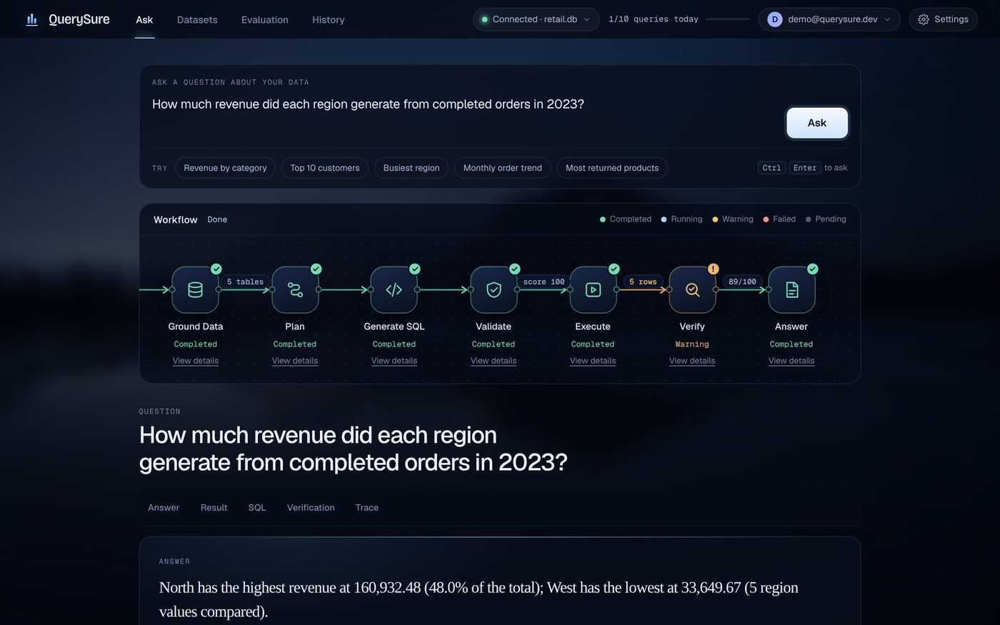
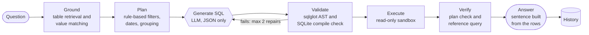
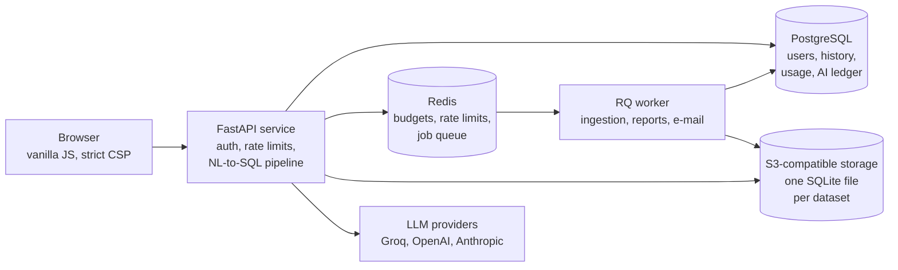

# QuerySure

**Ask a question about your data in plain English. Get the answer, the SQL behind it, and a record of every check it passed or failed.**


-brightgreen)



<sub>Local run. The SQL in this screenshot came from the stub model used by the test suite; every other stage ran for real.</sub>

## Why it exists

"Chat with your data" tools fail quietly. If a filter value is spelled differently from the data (`'Completed'` vs `'completed'`), you get an empty table that looks like "no sales". If a date filter is dropped, you get a real number for the wrong period. The reply sounds just as confident either way, and someone who doesn't write SQL can't tell.

QuerySure gives the language model **one job: writing SQL**. Everything around that step is deterministic, tested Python. It grounds the question in real data values, plans the query, validates the SQL, runs it in a read-only sandbox and checks the result independently. If an answer can't be confirmed, it is labelled **"not independently verified"** instead of being presented as correct.

## Features

- **Bring your own data:** upload CSV, JSON, Excel (XLSX/XLSM) or SQLite, or use the bundled 5-table retail sample. Uploads are converted to SQLite in the background, with size, row, column and zip-bomb limits.
- **Verifiable answers:** every answer shows its SQL, validation findings, a reliability score, a step-by-step trace and, for single-table questions, an independent recalculation.
- **Safe by construction:** only one read-only `SELECT`/`WITH` statement can run, enforced at four independent layers.
- **Multi-provider AI with cost control:** Groq → OpenAI → Anthropic fallback, with per-user and global daily budgets reserved before every call and a kill switch.
- **Accounts:** e-mail verification, password reset, optional Google sign-in, revocable sessions, data export and account deletion.
- **Query history:** search saved answers and their details (question, SQL, saved result, verification); entries are read-only snapshots, and deleting one asks for confirmation.
- **Clean dataset switching:** connecting a new file or the sample clears the previous question, answer, SQL, results and verification; a failed upload never replaces the active dataset.
- **Operations:** PII-safe JSON logs, metrics, SLOs, alerts, health and readiness probes, and an aggregate-only admin dashboard.
- **Evaluation harness:** a 62-question benchmark that grades by result set and detects hallucinated tables and columns.

## How a question becomes an answer

Only one of the eight stages calls a model.



## Architecture



Full details: [docs/02_ARCHITECTURE.md](docs/02_ARCHITECTURE.md).

## Tech stack

| Layer | Choice |
|---|---|
| API | Python 3.12, FastAPI 0.159, Starlette 1.9, Pydantic, slowapi |
| SQL safety | sqlglot (AST), SQLite authorizer, read-only connections |
| Data | pandas, openpyxl → SQLite |
| State | SQLAlchemy 2, Alembic (15 migrations), PostgreSQL 16 |
| Jobs and storage | Redis + RQ; boto3 for S3, Cloudflare R2 or MinIO |
| LLMs | Groq, OpenAI and Anthropic SDKs; order and model IDs set by environment variables |
| Auth | bcrypt, PyJWT (revocable server-side sessions), optional Google Identity Services |
| Frontend | Vanilla HTML/CSS/JS served from the same origin, self-hosted fonts |
| Quality | pytest, jsdom, Puppeteer, Ruff, pip-audit, GitHub Actions |
| Deployment | Docker (multi-stage, non-root), Docker Compose (development), Render blueprint |

## Prerequisites

- Python **3.12**
- At least one LLM API key (Groq, OpenAI or Anthropic) to generate SQL. Without one, the app runs, but questions cannot be answered.
- Optional: Docker with Compose v2 (PostgreSQL + Redis + worker stack); Node.js 20 (only for the jsdom XSS and browser tests).

## Run locally (no Docker)

```bash
pip install -r requirements.txt
cp .env.example .env          # add GROQ_API_KEY (or OPENAI_API_KEY / ANTHROPIC_API_KEY)
python start.py               # builds the sample database and serves http://localhost:5000
```

Local mode uses SQLite and runs background jobs inline. Verification e-mails are written to `.dev_mail/`; open the newest file to verify your account.

## Run with Docker Compose

The Compose stack is a **development** stack: PostgreSQL 16 (persistent volume `querysure_pgdata`), Redis 7, the API on **http://localhost:5001**, and an RQ worker. `docker-compose.yml` contains no credentials: Compose reads them from `.env` (variable substitution only) and stops with a message when `POSTGRES_PASSWORD` or `JWT_SECRET_KEY` is missing. Copy `.env.example` to `.env`, choose a `POSTGRES_PASSWORD` (letters, digits, `-`, `_`), generate a `JWT_SECRET_KEY` with `python -c "import secrets; print(secrets.token_urlsafe(64))"`, and add an LLM key. An existing `querysure_pgdata` volume keeps the password it was created with, so `POSTGRES_PASSWORD` must match it.

```bash
docker compose up -d --build
```
```bash
docker compose ps
```
```bash
docker compose logs -f api worker
```
```bash
docker compose exec worker sh -c 'cat .dev_mail/*.eml'
```
```bash
docker compose down
```

`docker compose down` keeps the database volume. **Do not add `-v`** unless you intend to delete all local data. The worker's healthcheck checks for its own Redis heartbeat, so `docker compose ps` should show `api` and `worker` as healthy.

## Health checks

```bash
curl -fsS http://localhost:5001/api/health
```
```bash
curl -fsS http://localhost:5001/api/ready
```

`/api/health` is a liveness probe. `/api/ready` returns 503 if PostgreSQL or Redis is unreachable, and 200 with `degraded` for non-critical problems (no worker, storage or AI providers unavailable). Use port 5000 for the non-Docker local run.

## Environment variables

`config.py` is the only module that reads the environment; [docs/ENVIRONMENT.md](docs/ENVIRONMENT.md) lists every variable (a test fails if one is missing). The ones you are most likely to set:

| Variable | Purpose |
|---|---|
| `GROQ_API_KEY`, `OPENAI_API_KEY`, `ANTHROPIC_API_KEY` | LLM providers (at least one) |
| `GROQ_MODEL`, `GROQ_FALLBACK_MODEL`, `OPENAI_FALLBACK_MODEL`, `ANTHROPIC_FALLBACK_MODEL` | Override model IDs when providers retire models |
| `DATABASE_URL`, `REDIS_URL` | PostgreSQL and Redis (SQLite and no Redis are allowed only outside production) |
| `JWT_SECRET_KEY` | Token signing secret (`start.py` generates one locally; required by Docker Compose) |
| `POSTGRES_USER`, `POSTGRES_PASSWORD`, `POSTGRES_DB` | Docker Compose only: database credentials (password required) |
| `EMAIL_PROVIDER`, `SMTP_*`, `EMAIL_FROM`, `APP_BASE_URL` | `dev` writes e-mails to files; production requires SMTP and an HTTPS base URL |
| `S3_BUCKET`, `S3_ENDPOINT_URL`, `S3_REGION`, `AWS_ACCESS_KEY_ID`, `AWS_SECRET_ACCESS_KEY` | Object storage (required in production) |
| `CORS_ALLOWED_ORIGINS`, `TRUSTED_PROXY_IPS` | Must be explicit in production |
| `DAILY_LLM_BUDGET_USD`, `GLOBAL_DAILY_AI_BUDGET_USD`, `AI_KILL_SWITCH` | AI cost controls |

With `ENVIRONMENT=production`, the app **refuses to start** with unsafe settings: CORS `*`, SQLite, no Redis, no S3, no SMTP, a non-HTTPS base URL or a JWT secret shorter than 16 characters. Never commit `.env`.

## Security highlights

- **Four SQL safety layers:** AST allow-list (single `SELECT`/`WITH`, known identifiers only) → read-only connection (`mode=ro`, `PRAGMA query_only`) → deny-by-default SQLite authorizer (no `ATTACH`, `PRAGMA`, `sqlite_*`, `load_extension`) → 15 s wall clock, 1,000-row and 1 MB-per-value caps. `/api/execute-sql` re-validates on every call.
- **Tenant isolation:** every session, dataset, job, report and history entry is owner-checked; other users get 404.
- **Prompt-injection defence:** file contents reach the model only inside nonce-tagged "untrusted data" blocks, and the validator stays the real gate.
- **Accounts:** bcrypt, rate-limited auth endpoints, JWTs bound to revocable server-side sessions, hashed single-use reset and verification tokens.
- **Browser:** escaped rendering, strict Content Security Policy, `X-Frame-Options: DENY`, HSTS in production.
- **Supply chain:** `pip-audit` reports no known vulnerabilities; CI runs it on every push.

## Tests and evaluation

```bash
pip install -r requirements-dev.txt
```
```bash
npm ci
```
```bash
python -m pytest -q
```
```bash
ruff check .
```
```bash
python -m evaluation run --mode oracle
```

`npm ci` is optional; without Node.js, the jsdom XSS and browser tests are skipped. `tests/test_v108_multiformat_eval.py` needs the owner's evaluation files, which are not in the repository (put them in `tests/fixtures/user/` or set `QUERYSURE_EVAL_DATA`; see [evaluation/README.md](evaluation/README.md)); without them it is skipped.

**Last verified run:** 1,171 passed, 0 failed, 14 skipped (1,167 passed, 18 skipped from the release ZIP, which leaves out the private evaluation files) (Python 3.12, SQLite, macOS, without the Node.js test dependencies); the PostgreSQL-only and Node/browser tests were among the skipped. The Docker Compose stack was checked by hand end to end (docs/03_EVALUATION.md, section 3.2). The offline benchmark reproduced 62/62 in `oracle` mode, and the validator let 0 of 5 hallucinating queries through in `synthetic` mode. See [docs/03_EVALUATION.md](docs/03_EVALUATION.md).

## Packaging a release

Never zip the folder by hand: Finder's *Compress* and `zip -r` ignore `.gitignore` and would include `.env`, local databases, private evaluation data, IDE settings, caches and `__MACOSX` metadata. Use

```bash
python scripts/package_release.py --out ../QuerySure_Final_Release.zip
```

It decides what ships itself (independently of `.gitignore`), writes one `querysure/` folder, then re-reads the archive and refuses to keep it if any excluded file, any value from your local `.env`, or a real-looking API key is found (it prints file names, never values). `python scripts/package_release.py --scan-git` runs the same scan over the files git tracks.

## Limitations

- **Live-model accuracy is only partly measured, and is well below 99%.** On the multi-format suite (CSV, Excel, JSON, two SQLite databases, 8 language/style variants), Groq `gpt-oss-120b` got 57.5% (tuned) and 60.9% (held-out) of the questions it answered exactly right, and about 63% on the Stats NZ CSV after the hierarchy fix ([section 3.3](docs/03_EVALUATION.md#33-hierarchical-statistics-files-stats-nz-csv-2026-10-24)); most calls were refused by the free-tier quota. With correct SQL supplied, the deterministic pipeline accepts and checks 212 of 212 runs without false alarms. See [docs/03_EVALUATION.md](docs/03_EVALUATION.md#31-multi-format-evaluation-2026-10-24).
- Independent recalculation covers single-table questions only, so most multi-table answers show "not independently verified".
- No clarifying questions for ambiguous requests.
- **Billing is not connected to a payment provider.** Only a provider-neutral webhook engine and a generic reference adapter exist ([docs/BILLING.md](docs/BILLING.md)).
- `render.yaml` uses free plans (PostgreSQL expires after 30 days; Key Value is not persistent). Upgrade before real users. Not production-validated.
- The auth token is kept in `localStorage` (mitigated by CSP and escaping); no MFA.

## Documentation

| Document | Contents |
|---|---|
| [Product](docs/01_PRODUCT.md) | Problem, users, journey, features, MVP scope, product decisions |
| [Architecture](docs/02_ARCHITECTURE.md) | Components, NL-to-SQL workflow, data flow, database, APIs, security, deployment |
| [Evaluation](docs/03_EVALUATION.md) | Test results, AI evaluation method and findings, security checks, limitations |
| [Sprint history](docs/SPRINT_HISTORY.md) | Seven-sprint retrospective reconstruction with stories, acceptance criteria and evidence |
| [API reference](docs/API.md) | Every route (checked against the code by a test) |
| [Environment variables](docs/ENVIRONMENT.md) | Every setting (checked against the code by a test) |
| [Operations](docs/OPERATIONS.md) | Deployment, monitoring, alerts, runbooks, backup and recovery |
| [Billing](docs/BILLING.md) | Payment adapter contract and webhook engine |
| [Evaluation harness](evaluation/README.md) · [Load tests](loadtests/README.md) | How to run the benchmark and the load tests |

## Repository map

```
api.py            HTTP routes and pipeline orchestration
config.py         all environment configuration and production guards
modules/          ingestion, profiling, retrieval, planner, SQL generator, validator, sandbox, verifier
ai_guard.py       AI budgets, timeouts, circuit breakers
jobs.py, worker.py  background jobs (RQ)
observability/    structured logs, metrics, SLOs, alerts, health
migrations/       Alembic migrations (15)
evaluation/       62-case benchmark harness
static/           frontend
tests/            pytest suite (69 files)
docs/             documentation
```
