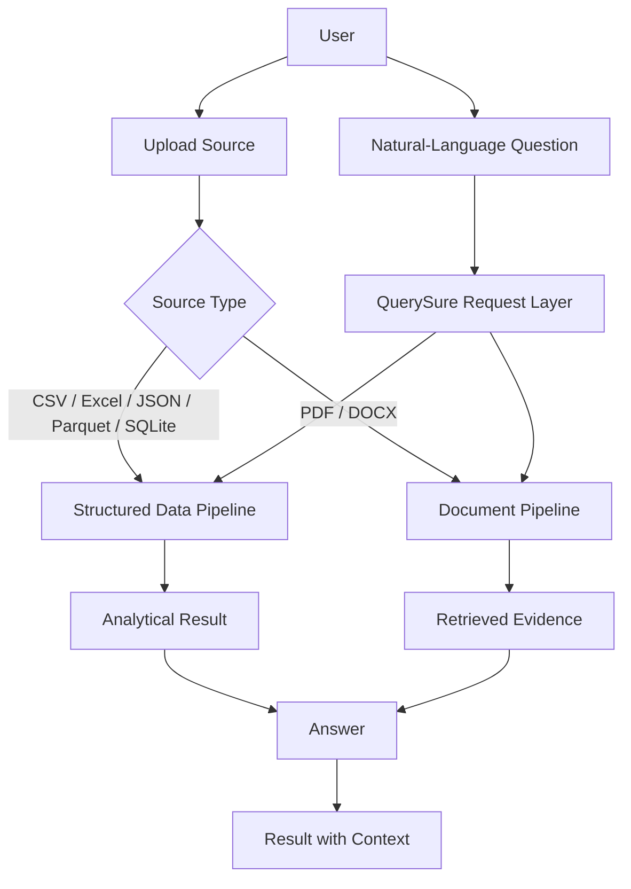
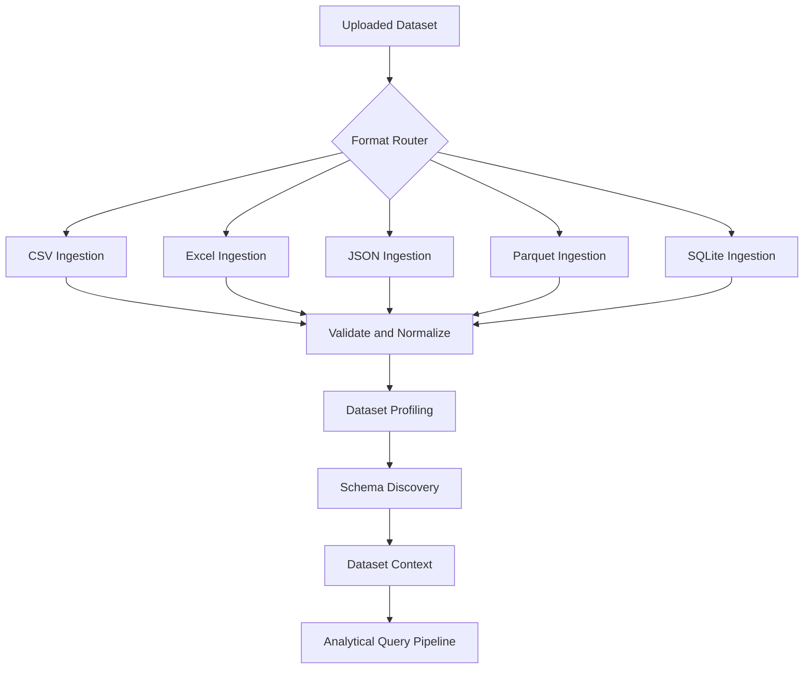
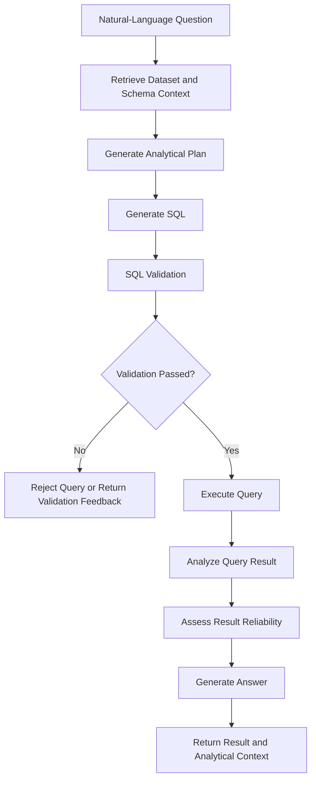
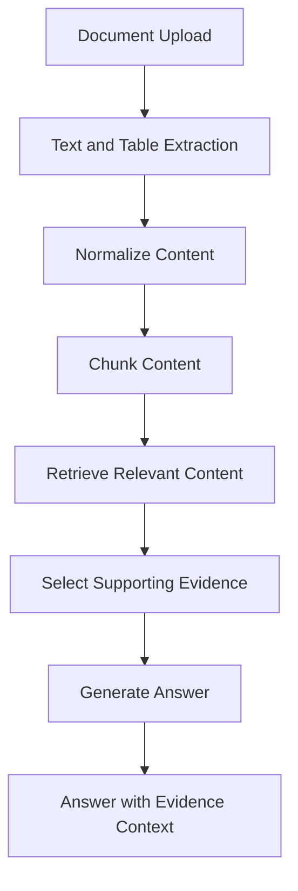
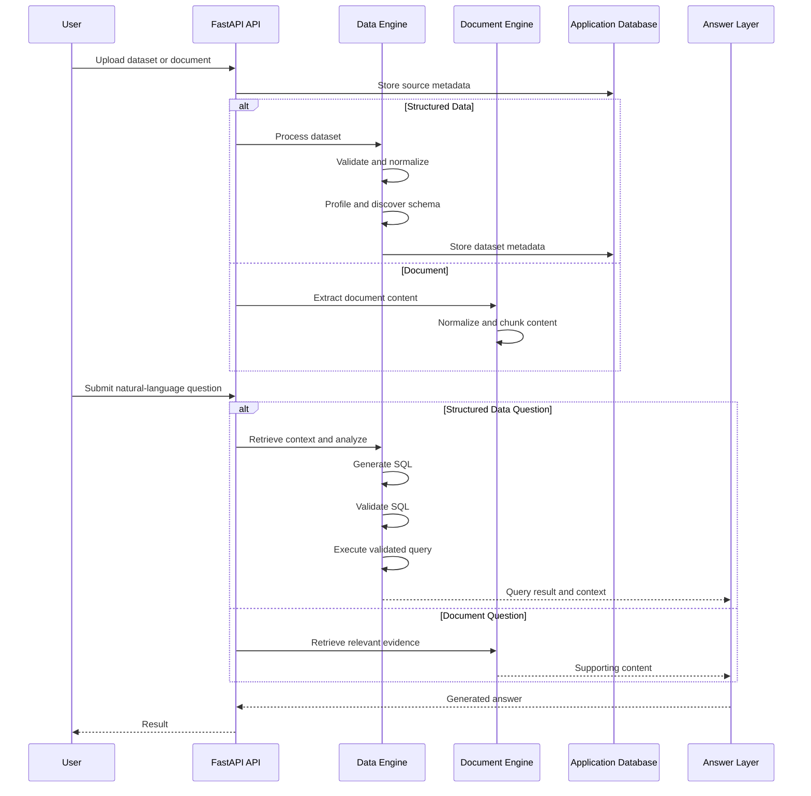
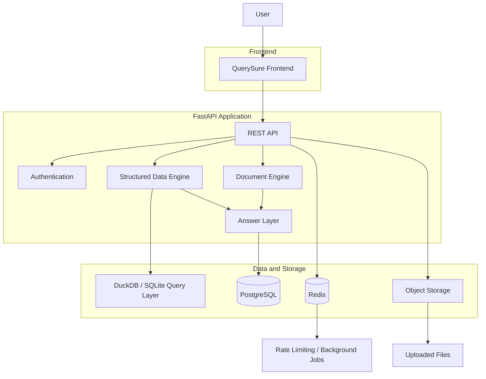
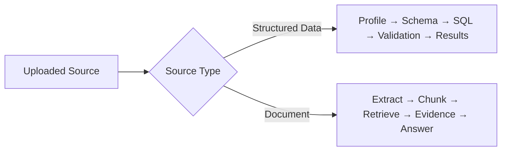

# QuerySure

## Natural-language analytics for structured data and documents

QuerySure is a full-stack analytics application that allows users to work with uploaded datasets and documents through natural-language questions.

The application handles two different source types:

* **Structured data** — CSV, Excel, JSON, Parquet, and SQLite
* **Documents** — PDF and DOCX

These sources follow different processing paths. Structured data is profiled and converted into analytical context before querying, while documents are extracted, chunked, and retrieved as supporting evidence.

For structured data, generated SQL is not executed immediately. Queries pass through a validation stage before execution, allowing analytical operations to be checked before they interact with the uploaded data.

> The project was initially developed around retail analytics use cases, but the ingestion and analysis flow is designed around dataset structure rather than a single fixed schema.

---

## What QuerySure does

A user can upload a dataset or document and ask questions about its contents.

For example:

* What were the highest-selling products last quarter?
* Which region generated the most revenue?
* How did revenue change month over month?
* Which customers contributed the highest percentage of sales?
* Show the top categories by growth.
* What does this document say about a particular topic?

The application routes the request according to the uploaded source type.

## Demo Visuals




The core design decision is that a spreadsheet and a document are not treated as the same kind of source.

---


# Structured Data Pipeline

Structured data follows a format-aware ingestion path.

QuerySure supports:

* CSV
* Excel (`.xlsx`)
* JSON
* Parquet
* SQLite databases

Rather than assuming all uploaded files have the same structure, each format is routed through its appropriate ingestion process before being normalized into analytical context.



---

## Dataset Profiling

Before generating an analytical operation, QuerySure builds a profile of the uploaded dataset.

The profiling stage examines information such as:

* Row and column counts
* Inferred data types
* Missing values
* Unique values
* Duplicate records
* Numeric statistics
* Date ranges
* Potential primary keys
* Data-quality warnings

This information becomes part of the context available to the analytical layer.

The system therefore does not rely only on the user's question when determining what the available data represents.

---

## Schema Discovery and Relationship Inference

When an uploaded source contains multiple tables or sheets, QuerySure examines their structure to identify potential relationships.

For example:

```text
sales.customer_id
        │
        ▼
customers.customer_id
```

Relationship inference can consider:

* Column names
* Data types
* Uniqueness
* Value overlap
* Existing database foreign keys

Potential relationships can carry confidence information rather than being assumed solely because two columns have similar names.

This is particularly relevant for uploaded datasets, where schemas may be incomplete or foreign-key relationships may not be explicitly defined.

---

# Natural-Language Analytics

For structured data questions, QuerySure uses the available dataset and schema context to determine the required analysis.

The analytical layer can work with operations including:

* Filtering
* Aggregation
* Grouping
* Sorting
* Joins
* CTEs
* Subqueries
* Conditional logic
* Date-based analysis
* Rankings
* Percentages and ratios
* Growth analysis
* Month-over-month comparisons
* Year-over-year comparisons
* Running totals
* Moving averages
* Trend analysis
* Segmentation

Generated SQL is treated as an intermediate step rather than the final action.

---

# SQL Generation, Validation, and Execution

The structured-data path separates SQL generation from SQL execution.



The validation stage is intended to check generated SQL before execution.

The checks include patterns related to:

* Multi-statement execution
* Destructive operations
* Unauthorized table access
* Unsafe query structures

This keeps query validation separate from SQL generation rather than assuming generated SQL is automatically safe to execute.

---

# Document Pipeline

Documents follow a different path because document analysis does not require the same operations as structured analytics.

QuerySure currently supports:

* PDF
* DOCX



Where possible, extracted tables can remain structured rather than being treated only as plain text.

The document pipeline is therefore focused on locating and selecting relevant evidence before answer generation.

---

# End-to-End Request Flow



---

# System Architecture



### Component responsibilities

| Component              | Responsibility                                                    |
| ---------------------- | ----------------------------------------------------------------- |
| Frontend               | File upload, question submission, and results interface           |
| FastAPI                | API routes and application request handling                       |
| Structured Data Engine | Ingestion, profiling, schema discovery, and analytical processing |
| Document Engine        | Extraction, chunking, retrieval, and evidence selection           |
| Query Layer            | Analytical query execution using DuckDB and SQLite                |
| PostgreSQL             | Application metadata and persistent records                       |
| Redis                  | Rate limiting and job-related infrastructure                      |
| Object Storage         | Uploaded source files                                             |
| Answer Layer           | Producing responses from analytical results or retrieved evidence |

---

# Reliability and Safety

## SQL Validation

Generated SQL passes through validation before execution.

The validation layer is intended to prevent or reject unsafe patterns before they reach the query engine.

Checks cover areas such as:

* Multi-statement execution
* Destructive operations
* Unauthorized table access
* Unsafe query structures

---

## File Validation

Uploaded files are handled through validation and controlled processing.

The application includes controls for:

* File type validation
* File size limits
* Safe filename handling
* Path traversal protection
* Controlled parsing
* Dataset ownership checks

---

## Authentication

The application includes:

* User registration
* Secure password hashing
* JWT-based authentication
* Protected API routes

---

## Rate Limiting

Redis-backed rate limiting is used for endpoints that may be sensitive or computationally expensive.

---

# Technology Stack

| Layer                    | Technology                        | Usage                                  |
| ------------------------ | --------------------------------- | -------------------------------------- |
| Backend                  | Python + FastAPI                  | Application API and backend            |
| Data Processing          | Pandas                            | Data loading and processing            |
| Analytical Query Engine  | DuckDB                            | Analytical SQL execution               |
| Local Database Support   | SQLite                            | Structured data and database ingestion |
| Columnar Processing      | PyArrow                           | Parquet and columnar data handling     |
| Excel Processing         | OpenPyXL                          | Excel ingestion                        |
| ORM / Database Access    | SQLAlchemy                        | Application database access            |
| Validation               | Pydantic                          | Request and data models                |
| Application Database     | PostgreSQL                        | Persistent application metadata        |
| Caching / Infrastructure | Redis                             | Rate limiting and job support          |
| Migrations               | Alembic                           | Database schema migrations             |
| Containers               | Docker + Docker Compose           | Local service orchestration            |
| Retrieval                | Semantic / vector-based retrieval | Document context retrieval             |

---

# Operational Features

The application includes infrastructure and operational components beyond the analysis pipeline.

These include:

* Dockerized services
* PostgreSQL application database
* Redis integration
* Alembic database migrations
* Environment-based configuration
* Fail-fast configuration validation
* Request IDs
* Structured logging
* Health endpoints
* Readiness checks
* Rate limiting
* API authentication
* Automated tests
* CI/CD validation

---

# Health and Readiness

The API exposes endpoints intended for application monitoring.

## `GET /api/health`

Checks whether the application is running.

## `GET /api/ready`

Checks whether required runtime dependencies are ready.

The distinction is useful in deployment environments where a running application process is not necessarily ready to accept application traffic.

---

# Project Structure

The repository is organized around the main processing responsibilities:

```text
querysure/
│
├── backend/
│   ├── api/
│   │   └── routes/
│   │
│   ├── services/
│   │   ├── ingestion/
│   │   ├── profiling/
│   │   ├── schema/
│   │   ├── sql/
│   │   └── retrieval/
│   │
│   ├── validation/
│   │   ├── sql_validator/
│   │   └── file_validation/
│   │
│   ├── database/
│   │   ├── models/
│   │   ├── repositories/
│   │   └── migrations/
│   │
│   ├── auth/
│   └── core/
│
├── frontend/
│
├── tests/
│
├── docker-compose.yml
├── Dockerfile
├── requirements.txt
└── .env.example
```

---

# Running Locally

## Clone the repository

```bash
git clone <repository-url>
cd querysure
```

## Configure environment variables

Create a local environment file:

```bash
cp .env.example .env
```

Update the required values in `.env`.

---

## Start the application

```bash
docker compose up --build
```

The Docker environment starts the services required by QuerySure, including:

* QuerySure API
* PostgreSQL
* Redis

To stop the services:

```bash
docker compose down
```

To remove local containers and volumes:

```bash
docker compose down -v
```

---

# Development

Run the test suite:

```bash
pytest
```

Run database migrations:

```bash
alembic upgrade head
```

---

# Engineering Decisions

## Structured data and documents use separate pipelines

A dataset and a document require different processing strategies.

For structured data, the relevant questions are:

* What columns are available?
* What data types are present?
* Are there missing or duplicate values?
* How are tables related?
* What SQL operation is required?

For documents, the relevant questions are different:

* What content was extracted?
* How should it be chunked?
* Which sections are relevant to the question?
* What evidence supports the answer?

QuerySure keeps these pipelines separate and combines their outputs at the answer layer.

---

## SQL generation and execution are separate stages

The natural-language interface does not send generated SQL directly to the query engine.

The intended path is:

```text
Question
    ↓
Dataset Context
    ↓
Analytical Plan
    ↓
SQL Generation
    ↓
Validation
    ↓
Execution
    ↓
Result Assessment
    ↓
Answer
```

Validation is therefore part of the analytical workflow rather than a check added after query execution.

---

## Dataset context is built before analysis

Before generating an analytical operation, QuerySure profiles the dataset and examines its schema.

The available context can include:

* Columns
* Data types
* Data-quality information
* Potential relationships
* Dataset structure

This reduces the amount of information the analytical layer needs to infer solely from the user's natural-language question.

---

## The source determines the processing path

QuerySure does not force every uploaded source through an SQL pipeline or treat every source as unstructured text.



This separation is one of the central architectural decisions in the project.

---

# Use Cases

## Business Analytics

Analyze sales, customers, revenue, and operational data using natural-language questions.

## Dataset Exploration

Inspect unfamiliar datasets without manually writing every exploratory SQL query.

## Analytical Reporting

Generate answers and analytical summaries from structured business data.

## Document Analysis

Ask questions about uploaded reports and documents using retrieval and supporting evidence.

## Multi-Source Analysis

Work with structured datasets and documents inside the same application while preserving source-specific processing paths.

---

# Project Scope

QuerySure brings together several areas that are often implemented separately:

* File ingestion
* Dataset profiling
* Schema discovery
* Relationship inference
* Natural-language analytics
* SQL generation
* SQL validation
* Analytical query execution
* Document extraction
* Retrieval
* Authentication
* Rate limiting
* Containerized services
* Application monitoring

The project focuses on connecting these components into one application flow rather than presenting them as separate scripts or notebooks.

---

# Future Expansion

Potential areas for further development include:

* Additional data connectors
* Additional visualization options
* Scheduled reporting
* Collaborative workspaces
* Enterprise authentication providers
* Expanded governance controls
* Additional document formats
* Additional analytical workflows

---

## Project Context

QuerySure was built as a portfolio project to explore what sits around natural-language analytics beyond simply generating SQL.

The project combines:

* Understanding uploaded data
* Building schema context
* Generating analytical operations
* Validating generated SQL
* Processing documents separately from datasets
* Retrieving relevant evidence
* Returning answers with source-specific context

The central design decision behind QuerySure is:

> **Natural-language analytics is not only a SQL-generation problem. The system also needs to understand the source, determine the appropriate processing path, and validate operations before producing a result.**

---

Built by **Shreya Joshi**.
