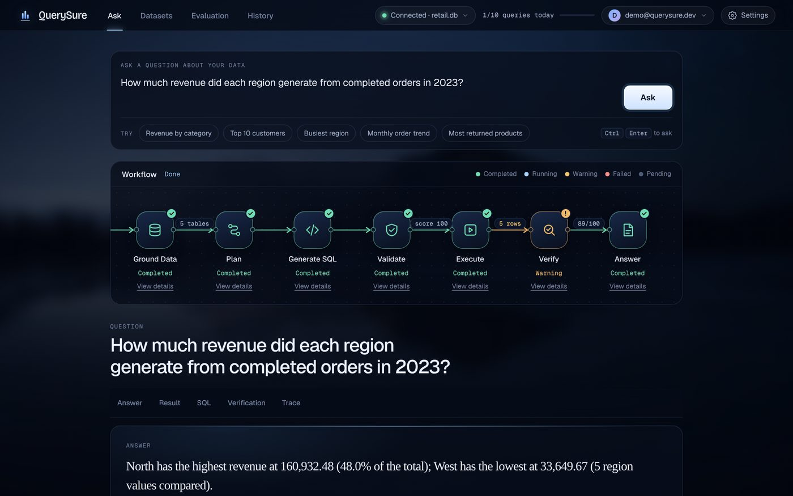
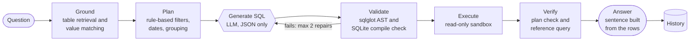
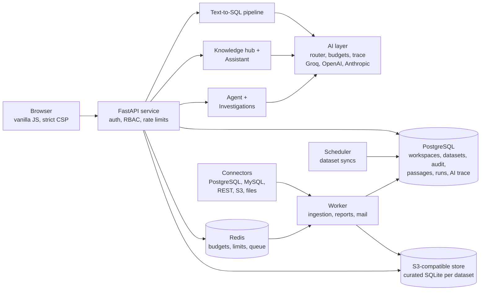

# QuerySure

**A self-hostable AI operations platform for company data: connect databases, files and documents, then ask questions, investigate changes and automate checks, with every answer showing its evidence and every risky action waiting for a person's approval.**


<sub>Local run. The SQL in this screenshot came from the stub model used by the test suite; every other stage ran for real.</sub>

## For reviewers: what to look at in five minutes

| If you care about | Look at | Evidence |
|---|---|---|
| **Product thinking** | [Product](docs/01_PRODUCT.md), [Capability map](docs/CAPABILITY_MAP.md) | Every capability is classified Working / Partial / Missing against the code, not the plan |
| **Backend engineering** | `api.py` plus 8 `*_api.py` modules, `workspaces.py`, `ingest.py`, `agent.py`, `investigation.py` | FastAPI, SQLAlchemy 2, 25 Alembic migrations, workspace RBAC (viewer / analyst / admin / owner), append-only audit log |
| **AI engineering** | `modules/sql_generator.py`, `knowledge.py`, `agent.py`, `ai/` | One job for the model per feature; everything around it is deterministic and tested. Multi-provider routing, budgets reserved before each call, full call trace |
| **AI safety** | `evaluation/platform/safety.py`, [Evaluation](docs/03_EVALUATION.md) | 36 adversarial cases (prompt injection through documents, forged plans, cross-tenant ids, SQL escapes) against the real controls: 36 / 36 blocked, run in CI |
| **Measurement honesty** | `docs/baseline/`, `evaluation/` | Retrieval recall with confidence intervals, a vector-database decision rule fixed *before* measuring, and every unmeasured thing listed as unmeasured |
| **Operations** | [Launch checklist](docs/LAUNCH_CHECKLIST.md), `scripts/launch_rehearsal.sh` | A production-mode rehearsal (real image, PostgreSQL, Redis, S3-compatible store, migrations on boot, backup, restore, restart) that exits non-zero on failure |

## What it does

- **Ask your data (Text-to-SQL):** upload CSV, JSON, Excel or SQLite, or connect PostgreSQL, MySQL, a REST API or an S3 bucket. The model only writes SQL; grounding, planning, validation, a read-only sandbox and an independent recalculation are deterministic code. Answers it cannot confirm are labelled "not independently verified".
- **Workspaces and datasets:** teams share versioned datasets with role-based access, scheduled syncs, import history, and a data-quality report (profile, anomalies, warnings) after every import.
- **Knowledge hub and Assistant:** upload `.txt`, `.md`, `.pdf` or `.docx`; ask in a private conversation and get answers that cite numbered passages. An answer that cites nothing valid is withheld. Retrieved text is treated as untrusted input.
- **Investigations:** trend, comparison and breakdown analyses that run real queries, keep the SQL behind every fact, label hypotheses as unverified, and export to JSON or HTML.
- **Controlled agent:** the model proposes a validated plan over six tools; reads run at once, writes (sync a dataset, delete a document) wait for an authorised person's approval and are re-checked at execution. The model never sees tool output.
- **Governance:** AI usage by task, provider and user from the call trace; audit log; per-user and global AI budgets and a kill switch; a workspace overview of what needs attention.

## Measured results (offline unless stated; regenerate with the commands in [evaluation/README.md](evaluation/README.md))

| Area | Result | Notes |
|---|---|---|
| Knowledge retrieval, keyword questions (n=24) | recall@3 **1.00** (95% CI 0.86-1.00) | TF-IDF; no vector database |
| Knowledge retrieval, paraphrased questions (n=60) | recall@3 **0.72** (CI 0.59-0.82) | Misses are listed in `docs/baseline/platform_eval.txt` |
| Off-topic questions that wrongly retrieve text (n=16) | **12.5%** | Cap is 25%; those cases are answered "insufficient" or withheld, never invented |
| Vector index decision | **not justified** | The rule was fixed before the numbers; it would flip if recall fell below the thresholds |
| Safety-adversarial suite | **36 / 36** blocked | Six control families; a deliberately broken control is shown to fail the suite |
| Search latency, 25,000 passages | **under 2 ms** per question after a one-off ~3 s index build | Sprint 13 inverted index; was 4.8 s *per question* at 30,000 |
| Production-mode rehearsal | see [LAUNCH_CHECKLIST](docs/LAUNCH_CHECKLIST.md) section 7 | Real stack on one machine; not a cloud deployment |
| Live model quality (SQL, plans, answers) | **see [Limitations](#limitations)** | Needs a funded key; `scripts/live_quality.sh` produces the numbers |

## How a question becomes an answer

Only one of the eight stages calls a model.



## Architecture



Full details: [docs/02_ARCHITECTURE.md](docs/02_ARCHITECTURE.md). Decisions worth reading: why retrieval stays TF-IDF (section "Knowledge hub"), why the agent cannot read tool output, why investigations are templates rather than free-form generation.

## Tech stack

| Layer | Choice |
|---|---|
| API | Python 3.12, FastAPI, Starlette, Pydantic, slowapi |
| SQL safety | sqlglot (AST), SQLite authorizer, read-only connections |
| Data | pandas, openpyxl, pyarrow → curated SQLite per dataset |
| State | SQLAlchemy 2, Alembic (25 migrations), PostgreSQL 16 |
| Jobs and storage | Redis + RQ; boto3 for S3, Cloudflare R2 or MinIO; a scheduler process for syncs |
| Retrieval | TF-IDF with an inverted index, one implementation shared by schema and document search |
| LLMs | Groq, OpenAI, Anthropic (Gemini and xAI adapters verified against stubs only); order and routing set by environment variables |
| Auth | bcrypt, PyJWT (revocable server-side sessions), optional Google Identity Services |
| Frontend | Vanilla HTML/CSS/JS served from the same origin, self-hosted fonts |
| Quality | pytest (about 1,550 tests), jsdom, Puppeteer, Ruff, pip-audit, GitHub Actions, real PostgreSQL and MySQL containers in CI |
| Deployment | Docker (multi-stage, non-root), Docker Compose, Render blueprint |

## Prerequisites

- Python **3.12**
- At least one LLM API key (Groq, OpenAI or Anthropic) to generate SQL. Without one, the app runs, but questions cannot be answered.
- Optional: Docker with Compose v2 (PostgreSQL + Redis + worker stack); Node.js 20 (only for the jsdom XSS and browser tests).

## Run locally (no Docker)

```bash
pip install -r requirements.txt
cp .env.example .env          # add GROQ_API_KEY (or OPENAI_API_KEY / ANTHROPIC_API_KEY)
python start.py               # builds the sample database and serves http://localhost:5000
```

Local mode uses SQLite and runs background jobs inline. Verification e-mails are written to `.dev_mail/`; open the newest file to verify your account.

## Run with Docker Compose

The Compose stack is a **development** stack: PostgreSQL 16 (persistent volume `querysure_pgdata`), Redis 7, the API on **http://localhost:5001**, and an RQ worker. `docker-compose.yml` contains no credentials: Compose reads them from `.env` (variable substitution only) and stops with a message when `POSTGRES_PASSWORD` or `JWT_SECRET_KEY` is missing. Copy `.env.example` to `.env`, choose a `POSTGRES_PASSWORD` (letters, digits, `-`, `_`), generate a `JWT_SECRET_KEY` with `python -c "import secrets; print(secrets.token_urlsafe(64))"`, and add an LLM key. An existing `querysure_pgdata` volume keeps the password it was created with, so `POSTGRES_PASSWORD` must match it.

```bash
docker compose up -d --build
```
```bash
docker compose ps
```
```bash
docker compose logs -f api worker
```
```bash
docker compose exec worker sh -c 'cat .dev_mail/*.eml'
```
```bash
docker compose down
```

`docker compose down` keeps the database volume. **Do not add `-v`** unless you intend to delete all local data. The worker's healthcheck checks for its own Redis heartbeat, so `docker compose ps` should show `api` and `worker` as healthy.

Two things that surprise people on the local stack:
- Uploaded files are stored inside the containers (as on a Render redeploy), so `docker compose up --build` loses them while the database keeps their records; such datasets then report that their file is not available. Re-upload, or set the `S3_*` variables to keep files in object storage as production does.
- Database connections refuse private and internal addresses (SSRF protection), so the stack's own `db` host is rejected. Set `CONNECTOR_ALLOW_PRIVATE_HOSTS=true` in `.env` to test connections against local databases.

## Health checks

```bash
curl -fsS http://localhost:5001/api/health
```
```bash
curl -fsS http://localhost:5001/api/ready
```

`/api/health` is a liveness probe. `/api/ready` returns 503 if PostgreSQL or Redis is unreachable, and 200 with `degraded` for non-critical problems (no worker, storage or AI providers unavailable). Use port 5000 for the non-Docker local run.

## Environment variables

`config.py` is the only module that reads the environment; [docs/ENVIRONMENT.md](docs/ENVIRONMENT.md) lists every variable (a test fails if one is missing). The ones you are most likely to set:

| Variable | Purpose |
|---|---|
| `GROQ_API_KEY`, `OPENAI_API_KEY`, `ANTHROPIC_API_KEY` | LLM providers (at least one) |
| `GROQ_MODEL`, `GROQ_FALLBACK_MODEL`, `OPENAI_FALLBACK_MODEL`, `ANTHROPIC_FALLBACK_MODEL` | Override model IDs when providers retire models |
| `DATABASE_URL`, `REDIS_URL` | PostgreSQL and Redis (SQLite and no Redis are allowed only outside production) |
| `JWT_SECRET_KEY` | Token signing secret (`start.py` generates one locally; required by Docker Compose) |
| `POSTGRES_USER`, `POSTGRES_PASSWORD`, `POSTGRES_DB` | Docker Compose only: database credentials (password required) |
| `EMAIL_PROVIDER`, `SMTP_*`, `EMAIL_FROM`, `APP_BASE_URL` | `dev` writes e-mails to files; production requires SMTP and an HTTPS base URL |
| `S3_BUCKET`, `S3_ENDPOINT_URL`, `S3_REGION`, `AWS_ACCESS_KEY_ID`, `AWS_SECRET_ACCESS_KEY` | Object storage (required in production) |
| `CORS_ALLOWED_ORIGINS`, `TRUSTED_PROXY_IPS` | Must be explicit in production |
| `DAILY_LLM_BUDGET_USD`, `GLOBAL_DAILY_AI_BUDGET_USD`, `AI_KILL_SWITCH` | AI cost controls |

With `ENVIRONMENT=production`, the app **refuses to start** with unsafe settings: CORS `*`, SQLite, no Redis, no S3, no SMTP, a non-HTTPS base URL or a JWT secret shorter than 16 characters. Never commit `.env`.

## Security highlights

- **Four SQL safety layers:** AST allow-list (single `SELECT`/`WITH`, known identifiers only) → read-only connection (`mode=ro`, `PRAGMA query_only`) → deny-by-default SQLite authorizer (no `ATTACH`, `PRAGMA`, `sqlite_*`, `load_extension`) → 15 s wall clock, 1,000-row and 1 MB-per-value caps. `/api/execute-sql` re-validates on every call.
- **Tenant isolation:** every session, dataset, job, report and history entry is owner-checked; other users get 404.
- **Prompt-injection defence:** file contents reach the model only inside nonce-tagged "untrusted data" blocks, and the validator stays the real gate.
- **Accounts:** bcrypt, rate-limited auth endpoints, JWTs bound to revocable server-side sessions, hashed single-use reset and verification tokens.
- **Browser:** escaped rendering, strict Content Security Policy, `X-Frame-Options: DENY`, HSTS in production.
- **Supply chain:** `pip-audit` reports no known vulnerabilities; CI runs it on every push.

## Tests and evaluation

```bash
pip install -r requirements-dev.txt
```
```bash
npm ci
```
```bash
python -m pytest -q
```
```bash
ruff check .
```
```bash
python -m evaluation run --mode oracle
```
```bash
python -m evaluation.platform
```
```bash
scripts/launch_rehearsal.sh
```

`npm ci` is optional; without Node.js, the jsdom XSS and browser tests are skipped. The browser test uses a Linux Chromium build; on macOS or Windows point it at a local Chrome, e.g. `CHROME_PATH="/Applications/Google Chrome.app/Contents/MacOS/Google Chrome"`. `tests/test_v108_multiformat_eval.py` needs the owner's evaluation files, which are not in the repository (put them in `tests/fixtures/user/` or set `QUERYSURE_EVAL_DATA`; see [evaluation/README.md](evaluation/README.md)); without them it is skipped.

**Last verified run (Sprint 13, 2026-11-07):** 1,503 passed, 0 failed, 46 skipped on SQLite; 1,536 passed, 0 failed, 14 skipped against real PostgreSQL 16 with PostgreSQL and MySQL 8.4 as data sources (Python 3.12, macOS); the two browser tests were not re-run this sprint (no UI change; last run 2 of 2). Alembic upgrade, check, downgrade and upgrade ran clean on PostgreSQL, Ruff is clean, and `scripts/launch_rehearsal.sh` passed. The offline SQL benchmark reproduced 62/62 in `oracle` mode (a harness self-check, not a model score). See [docs/03_EVALUATION.md](docs/03_EVALUATION.md).

## Packaging a release

Never zip the folder by hand: Finder's *Compress* and `zip -r` ignore `.gitignore` and would include `.env`, local databases, private evaluation data, IDE settings, caches and `__MACOSX` metadata. Use

```bash
python scripts/package_release.py --out ../QuerySure_Final_Release.zip
```

It decides what ships itself (independently of `.gitignore`), writes one `querysure/` folder, then re-reads the archive and refuses to keep it if any excluded file, any value from your local `.env`, or a real-looking API key is found (it prints file names, never values). `python scripts/package_release.py --scan-git` runs the same scan over the files git tracks.

## Limitations

What is **not** proven, stated up front:

- **Live-model quality is only partly measured, and is well below 99%.** On the multi-format SQL suite, Groq `gpt-oss-120b` got 57.5% (tuned) and 60.9% (held-out) of questions exactly right, and about 63% on the Stats NZ CSV after the hierarchy fix ([details](docs/03_EVALUATION.md#31-multi-format-evaluation-2026-10-24)); most calls were refused by the free-tier quota. **Agent-plan quality and cited-answer quality with a real model have not been measured at all.** The tooling exists (`scripts/live_quality.sh`, `python -m evaluation.platform --suite answers --mode live`) but needs a funded key; the offline numbers above test the code around the model, not the model.
- **Retrieval is lexical.** Paraphrased questions miss about 28% of the time (recall@3 0.72). A vector index was measured against a rule fixed in advance and is not justified yet; it would be reconsidered if live results show paraphrase misses dominate.
- **Citations are checked for existence, not factual support.** An answer can cite a real passage and still be wrong.
- **Deployment is rehearsed, not operated.** The production-mode rehearsal passes on one machine ([checklist section 7](docs/LAUNCH_CHECKLIST.md)); there has been no cloud deployment, no real mail delivery check, no PostgreSQL or concurrent-load benchmark.
- Capacity limits: 25,000 passages per workspace (about 285 MB of index per active workspace), 500,000 rows per table for investigations.
- Independent recalculation covers single-table questions only, so most multi-table answers show "not independently verified". No clarifying questions for ambiguous requests.
- **Billing is not connected to a payment provider.** Only a provider-neutral webhook engine and a generic reference adapter exist ([docs/BILLING.md](docs/BILLING.md)).
- `render.yaml` uses free plans (PostgreSQL expires after 30 days; Key Value is not persistent). Upgrade before real users.
- The auth token is kept in `localStorage` (mitigated by CSP and escaping); no MFA.

## Documentation

| Document | Contents |
|---|---|
| [Index](docs/README.md) · [User guide](docs/USER_GUIDE.md) · [Developer guide](docs/DEVELOPMENT.md) · [Design decisions](docs/DECISIONS.md) | Start here, by role |
| [Product](docs/01_PRODUCT.md) | Problem, users, journey, features, MVP scope, product decisions |
| [Architecture](docs/02_ARCHITECTURE.md) | Components, NL-to-SQL workflow, data flow, database, APIs, security, deployment |
| [Evaluation](docs/03_EVALUATION.md) | Test results, AI evaluation method and findings, security checks, limitations |
| [Sprint history](docs/SPRINT_HISTORY.md) | Thirteen-sprint record with acceptance criteria and evidence |
| [API reference](docs/API.md) | Every route (checked against the code by a test) |
| [Environment variables](docs/ENVIRONMENT.md) | Every setting (checked against the code by a test) |
| [Capability map](docs/CAPABILITY_MAP.md) | Every capability classified against the code, with evidence |
| [Launch checklist](docs/LAUNCH_CHECKLIST.md) | Gates, production configuration, smoke test, recovery checks and the production-mode rehearsal |
| [Baselines](docs/baseline/) | Measured retrieval, safety and latency numbers, regenerated by commands |
| [Operations](docs/OPERATIONS.md) | Deployment, monitoring, alerts, runbooks, backup and recovery |
| [Billing](docs/BILLING.md) | Payment adapter contract and webhook engine |
| [Evaluation harness](evaluation/README.md) · [Load tests](loadtests/README.md) | How to run the benchmark and the load tests |

## Repository map

```
api.py, *_api.py     HTTP routes (auth, workspaces, datasets, connections, conversations, agent, investigations, governance)
config.py            all environment configuration and production guards
workspaces.py        tenancy and roles (the single permission check)      audit.py   append-only audit log
modules/             ingestion, profiling, retrieval, planner, SQL generator, validator, sandbox, verifier
ingest*.py, quality.py, connectors/, scheduler.py   dataset imports, sources, data quality, scheduled syncs
knowledge.py, assistant.py, agent.py, investigation.py   documents + cited answers, chat, controlled agent, investigations
ai/, ai_guard.py     provider routing, budgets, circuit breakers, call trace
jobs.py, worker.py   background jobs (RQ)            observability/   logs, metrics, SLOs, alerts, health
migrations/          Alembic migrations (25)         static/           frontend
evaluation/          SQL benchmark + platform suites (retrieval, agent, answers, safety, perf)
scripts/             backups, restore check, release packaging, launch rehearsal, smoke test, live quality run
tests/               pytest suite                    docs/            documentation and measured baselines
```
