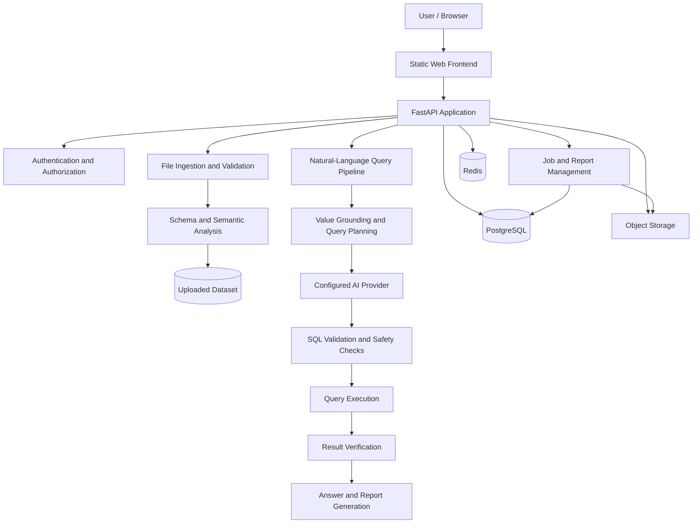

# QuerySure — System Architecture

## 1. System Overview

QuerySure is an AI-powered data analysis application that allows users to upload structured datasets and ask questions in natural language. The system converts questions into SQL, validates the proposed queries, executes them against the uploaded dataset, and returns results with optional reports.

The architecture separates the web interface, API and authentication layer, data-processing pipeline, persistence layer, and operational components.

## 2. High-Level Architecture

*The diagram represents the logical architecture; deployment and execution details should be checked against the current implementation.*

## 3. Application Components

### Frontend
The browser interface provides registration and login, dataset uploads, natural-language questions, results, query history, and reports. The static application is maintained under `static/`.

### API and Authentication
The FastAPI application exposes application endpoints and coordinates authentication, uploads, queries, and reports. Authentication-related modules manage account security and verification. Protected operations must enforce authorization and user isolation.

### Data Ingestion
The ingestion pipeline accepts supported formats including CSV, Excel, JSON, and SQLite databases. It inspects the input, derives schema information, and prepares data for querying. Upload limits and processing time depend on the deployment configuration and file format.

### Natural-Language-to-SQL Pipeline
The query pipeline uses schema information, value grounding, intent analysis, query planning, and a configured AI provider to generate SQL. Validation and execution safeguards are applied before results are returned. Result-verification components help detect inconsistencies in generated answers.

### Background Jobs and Reports
The application tracks processing jobs and report generation. A dedicated worker can process queued jobs when deployed. In the Render Free demo configuration, supported jobs can instead execute inside the web process when no worker is available. This fallback is not durable: a restart or crash can interrupt a running job.

## 4. Data and Persistence

| Component | Responsibility |
|---|---|
| PostgreSQL | Application records, accounts, job metadata, and other persistent relational data |
| Redis | Configured caching, coordination, and rate-limiting or queue functionality |
| Object storage | Uploaded files and stored reports |
| Uploaded datasets | Structured data used by the query pipeline |

Database schema changes are managed through the repository's migration system. Production connections must use the correct service credentials and network configuration.

## 5. Security and Reliability

The architecture includes authentication and authorization controls, password and verification workflows, request validation, SQL safety checks, rate limits, quotas, and operational logging.

These controls must be validated through tests and deployment checks; their presence in the source tree alone does not establish that every production workflow is secure or reliable.

## 6. Deployment

QuerySure is containerized using the repository's Docker configuration. The current deployment target is Render, with the web application configured to use PostgreSQL and any required Redis and object-storage services.

For a free-demo deployment, use a single web service where feasible. Do not create paid worker or cron services unless the corresponding functionality is needed. Configure secrets privately through the hosting platform.

## 7. Known Deployment Limitations

- Free web services may sleep after inactivity and have limited CPU and memory.
- Free database availability and retention are subject to the hosting provider's limits.
- In-process jobs can be interrupted by a service restart.
- Large uploads, especially Excel workbooks, can take a long time or exceed available resources.
- AI answer accuracy and end-to-end reliability must be reported from representative evaluation results, not inferred from successful execution of known-correct queries.

## 8. Validation and Maintenance

Validate the architecture against the current source code, deployment configuration, CI results, and actual running service. Keep this document updated when components, data flows, security controls, or deployment assumptions change.
