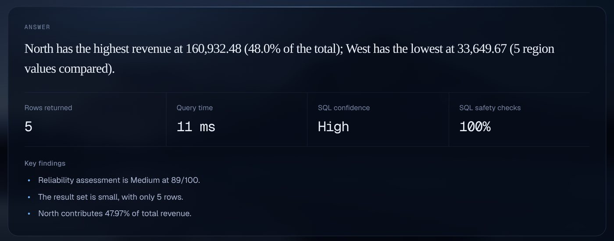

# QuerySure — Product

**Ask a question about your own data in plain English. Get the answer, the SQL behind it, and a record of every check it passed or failed.**

Version 1.0.7 · Related: [Architecture](02_ARCHITECTURE.md) · [Evaluation](03_EVALUATION.md) · [Sprint history](SPRINT_HISTORY.md)

## Problem

Small teams keep their numbers in CSV and Excel exports. Every question ("which region sold the most last quarter?") means writing SQL or waiting for someone who can. "Chat with your data" tools remove the wait, but they fail in a way users cannot see: the answer sounds equally confident when it is wrong.

- A filter value is spelled differently from the data (`'Completed'` vs `'completed'`), so the table comes back empty and reads as "no sales".
- A date filter is silently dropped, so the total is real but for the wrong period.
- A rate is averaged instead of recalculated, so the figure is slightly off and nobody notices.

**Problem statement:** people who don't write SQL need answers they can check, not answers they have to trust.

## Target users

| User | Situation | What they need |
|---|---|---|
| **Operations or business analyst** at a small company (primary) | Data lives in CSV/Excel exports; no BI team; SQL is a blocker | A table or chart in seconds, from their own file |
| **Founder or manager** | Must decide whether a figure is safe to put in a report | A one-line answer plus a clear "verified / not verified" signal |
| **Data-literate reviewer** | Asked to sign off on an AI-produced number | The exact SQL, every check it passed, and a saved snapshot of the result |

## Value proposition

QuerySure gives the language model **one job: writing SQL**. Grounding, planning, validation, execution, verification and the answer sentence are deterministic code. The product therefore makes three promises:

| Promise | How it is kept |
|---|---|
| **It only reads your data** | The SQL must be a single `SELECT`/`WITH` over real tables and columns, and it runs on a read-only connection that blocks writes at the database level |
| **It shows what it checked** | Every answer carries its SQL, validation findings, a reliability score and a step-by-step trace |
| **It never pretends** | An answer is called verified only when an independent recalculation matches; otherwise it is labelled "not independently verified" |

## User journey

| Step | User action | Product response |
|---|---|---|
| 1. Sign up | E-mail and password (verification link), or Google if configured | Revocable session; Free plan |
| 2. Bring data | Upload CSV, JSON, Excel or SQLite, or use the bundled sample | Converted to SQLite in the background, every column profiled, preview shown |
| 3. Ask | "How much revenue did each region generate from completed orders in 2023?" | The 8-stage workflow runs on screen: Ground → Plan → Generate SQL → Validate → Execute → Verify → Answer → Record |
| 4. Read | Answer sentence, findings, chart or table | The sentence states what the rows show ("North has the highest revenue at 160,932.48 (48.0% of the total)…") |
| 5. Check | Opens SQL, Verification or Trace | SQL, validation findings, and whether an independent recalculation agreed |
| 6. Review | Exports CSV/JSON, or looks an answer up in History | History shows the saved question, SQL, result and verification exactly as they were ("Result not saved" when none was stored); it is never re-run |

*Local run. The SQL in this screenshot came from the stub model used by the test suite; every other stage ran for real.*

## Core features

| Area | Features |
|---|---|
| Data | Upload CSV, JSON, XLSX/XLSM, SQLite (size, row, column, sheet and zip-bomb limits); bundled 5-table retail sample; paginated dataset preview |
| Answering | Value grounding, rule-based query plan, LLM SQL generation with up to 2 repair rounds, AST validation, read-only execution, independent verification for single-table plans |
| Trust | SQL view, validation findings, reliability score capped when unverified, "Low confidence" label when retrieval found little relevant schema, per-question trace |
| History | Search saved snapshots and their details; confirmed delete; owner-scoped |
| Dataset switching | A new upload or the sample clears the previous question, answer, SQL, results and verification; a failed upload leaves the current dataset active |
| Accounts | E-mail verification, password reset, optional Google sign-in, sign out everywhere, data export, account deletion |
| Limits | Daily question limits per plan, per-user and global daily AI budgets, storage quotas |
| Operations | Admin `/ops` dashboard with aggregate metrics only, health and readiness probes, alerts |

## MVP scope

| In scope (v1.0.7) | Out of scope |
|---|---|
| File-based datasets converted to SQLite | Live connections to customer databases |
| One user per account | Organisations, seats, shared workspaces |
| Free plan with 10 questions/day; Pro tier defined at $5/month for 50/day | A connected payment provider (only a provider-neutral webhook engine and a generic reference adapter exist; see [BILLING.md](BILLING.md)) |
| Answering or declining a question | Clarifying questions for ambiguous asks |
| Background report generation per question | Report download from the main UI |
| E-mail/password and Google sign-in | MFA |

## Product decisions

| Decision | Why | Trade-off accepted |
|---|---|---|
| Show the work in the main view, behind folds | Checking is the reason to use QuerySure over a chat tool | More on screen; the answer sentence comes first |
| The answer sentence is generated from the rows by rules, not by the LLM | It cannot state facts that are not in the result | Less fluent than an LLM summary |
| Never call an answer "verified" without an independent recalculation | A validation score only means "safe and well-formed" | Most multi-table answers show "not independently verified" |
| Read-only by design, enforced at two levels | A validator bug must not become data loss | No write-back or "fix my data" features |
| AI budget reserved before every call; hard daily limits | A public demo must not run up an unbounded LLM bill | If Redis and the database are both unavailable, AI requests are refused |
| Files, not live databases | No customer credentials or network access to secure | Users must export their data first |
| Multi-provider fallback with model IDs in configuration | Providers retire models (Groq retired the previous defaults on 2026-08-16) | More configuration to maintain |

## Success metrics (targets, not results)

No real users have used the product yet, so these are targets and the instrument that would measure each.

| Goal | Metric (target) | Instrument in the code |
|---|---|---|
| Answers are right | Execution accuracy on the 62-case benchmark with a live model (≥ 70%) | `python -m evaluation live` (not yet run) |
| Answers are safe | Writes or validator escapes reaching data (0) | Validator, SQLite authorizer, benchmark hallucination checks |
| Users reuse it | Share of answers exported or looked up in History; 7-day return rate | `query_history`, `usage_daily` |
| Cost stays bounded | AI cost per answered question (< $0.01) | `ai_invocations` |

## Roadmap

1. Run the live benchmark with a provider key and publish accuracy, hallucination rate and cost per question.
2. Recalibrate the "Low confidence" threshold on live results.
3. Add a clarification step for ambiguous questions.
4. Extend independent verification to simple two-table joins.
5. Connect a real payment provider adapter, tested against its sandbox.
