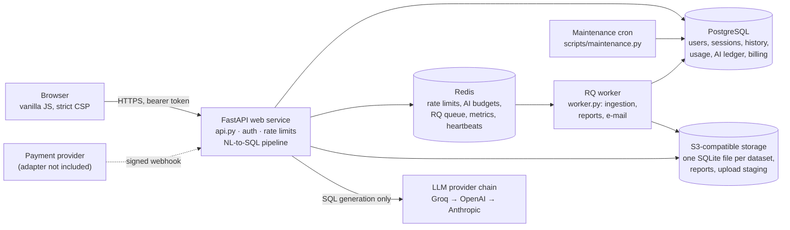

# QuerySure — Architecture

QuerySure turns a plain-English question about a user's own dataset into one validated, read-only SQL query, runs it in a sandbox, checks the result, and records how the answer was produced. **Only one stage calls a language model** (writing SQL). Everything before and after it is deterministic Python that behaves the same on every run and is covered by unit tests.

Related: [Product](01_PRODUCT.md) · [Evaluation](03_EVALUATION.md) · [API reference](API.md) · [Environment variables](ENVIRONMENT.md) · [Operations and deployment](OPERATIONS.md)

## System architecture

One FastAPI process serves both the JSON API and the static frontend (`static/`) from the same origin. Slow work runs on an RQ worker. Without `REDIS_URL` (local development), jobs run inline and limits are kept in process memory; production refuses to start without Redis.

## End-to-end NL-to-SQL workflow

```mermaid
flowchart LR
    Q([Question]) --> G["1 Ground<br/>TF-IDF table retrieval,<br/>value matching"]
    G --> P["2 Plan<br/>rule-based"]
    P --> L{{"3 Generate SQL<br/>LLM, JSON reply"}}
    L --> V["4 Validate<br/>sqlglot AST +<br/>SQLite compile check"]
    V -- "fails: repair, max 2 rounds" --> L
    V --> X["5 Execute<br/>read-only sandbox"]
    X --> R["6 Verify<br/>plan check, independent<br/>reference query"]
    R --> A["7 Answer<br/>rule-based sentence,<br/>chart, reliability score"]
    A --> H["8 Record<br/>history, report job"]
```

| # | Stage | What happens | Code | LLM |
|---|---|---|---|---|
| 1 | Ground | Profile tables and columns, including long-format statistics tables (hierarchy levels and alternative versions that must never be added together, detected from the data: `modules/long_format.py`); TF-IDF retrieval picks relevant tables; words in the question are matched against real stored values (`"completed"` → `'Completed'`) | `modules/schema_engine.py`, `retrieval_engine.py`, `value_grounding.py`, `semantic_layer.py` | No |
| 2 | Plan | Rules extract measure, aggregation, filters, date range, grouping, ordering and limit; on a long-format table, one hierarchy level and one version are fixed from the question ("top-level", "level 2", a named version) | `modules/query_planner.py` | No |
| 3 | Generate | Prompt = schema subset + column profiles + matched values + plan + question, each in nonce-tagged "untrusted data" blocks. Reply must be JSON `{sql, explanation, confidence, complexity}` (Pydantic); invalid JSON is retried once | `modules/sql_generator.py`, `ai_guard.py` | **Yes** |
| 4 | Validate | sqlglot AST: exactly one `SELECT`/`WITH`, only known tables and columns, joins traced through CTEs, no Cartesian joins; must compile in SQLite (`EXPLAIN` on an in-memory schema twin). A specific failure reason goes back to the model, at most 2 repair rounds | `modules/sql_validator.py`, `sqlite_compile_check.py`, `sql_intent_checker.py` | Repair only |
| 5 | Execute | Read-only connection, string literals bound as parameters, 15 s wall clock, 1,000-row cap | `modules/query_result_engine.py`, `sql_params.py` | No |
| 6 | Verify | SQL compared with the plan (including SQL that adds hierarchy levels or versions together, or uses `<>` on a mostly-NULL column); where the plan is unambiguous (single-table), an independent reference query is run and results compared; empty results checked against real values | `modules/result_verifier.py` | No |
| 7 | Answer | Answer sentence, findings and chart built from the returned rows; reliability score capped when not independently verified | `modules/business_insight_agent.py`, `data_reliability_agent.py`, `trust_trace.py` | No |
| 8 | Record | Saved to owner-scoped history (500 entries per user, results capped at 200 rows / 200 KB); report built by a background job | `history_service.py`, `modules/report_generator.py`, `jobs.py` | No |

`POST /api/execute-sql` re-validates the exact SQL it is about to run on every call, so a client cannot skip validation by posting SQL directly.

## Components

| Component | Files | Responsibility |
|---|---|---|
| HTTP API and frontend | `api.py`, `workspace_api.py`, `dataset_api.py`, `connection_api.py`, `conversation_api.py`, `agent_api.py`, `investigation_api.py`, `governance_api.py`, `static/` | 112 application routes, same-origin static frontend, security headers, admission control |
| Pipeline | `modules/` | Ingestion, profiling, retrieval, planning, generation, validation, execution, verification, answer |
| Configuration | `config.py` | The only module that reads environment variables; production start-up guards |
| Accounts | `auth.py`, `account_service.py`, `email_provider.py` | bcrypt, JWT bound to revocable sessions, e-mail verification and reset, optional Google sign-in, export and deletion |
| Plans, quotas, AI guard | `entitlements.py`, `quotas.py`, `ai_guard.py` | Daily question limits, storage quotas, AI budgets, circuit breakers, kill switch |
| Background jobs | `jobs.py`, `worker.py` | RQ jobs for ingestion, reports and e-mail; inline when Redis is absent |
| Storage | `storage.py`, `report_storage.py` | Local disk (development) or S3; per-user key prefixes checked on every access |
| Billing | `payment_provider.py`, `billing_service.py` | Provider-neutral adapter boundary and idempotent webhook engine ([BILLING.md](BILLING.md)) |
| Operations | `observability/`, `ops_api.py`, `scripts/` | Structured logs, metrics, SLOs, alerts, 8 aggregate-only admin routes, backup and maintenance scripts |
| Evaluation | `evaluation/` | 62-case benchmark harness (see [03_EVALUATION.md](03_EVALUATION.md)) |

## Data flow

1. **Upload.** `POST /api/connect/upload` streams the file to disk with a size limit (`MAX_UPLOAD_MB`, default 10 MB, under per-type ceilings of CSV/JSON 50 MB, Excel 50 MB, SQLite 100 MB), checks the user's quota, stages it (S3 in production) and returns `202` with a job ID.
2. **Ingestion.** The worker (or, with no worker alive and `JOB_EXECUTION=auto`, the web process right after the response; not durable, see [OPERATIONS.md](OPERATIONS.md#render-free-demo-mode)) converts CSV, JSON or Excel into one SQLite file (row, column, sheet and zip-bomb caps), profiles it, and stores it under the user's prefix. The bundled sample (`create_retail.py`) is a deterministic 5-table retail database.
3. **Question.** The pipeline above reads the dataset through a local read-only copy (`storage.ensure_local`). The LLM receives schema context and the question; it never receives full data rows.
4. **Result.** Rows, SQL, validation and trace are stored on the user's `pipeline_sessions` row and in `query_history`; the browser renders them with escaped output.

## Database

PostgreSQL in production (SQLite allowed only outside production), managed by **20 Alembic migrations**; CI runs `alembic upgrade head` and `alembic check` against Postgres 16.

| Area | Tables |
|---|---|
| Identity | `users`, `auth_sessions`, `email_verification_tokens`, `password_reset_tokens` |
| Workspaces | `workspaces` (personal or team), `workspace_members` (owner / admin / analyst / viewer), `datasets` (catalog; workspace-owned storage, versioned), `ingestion_runs` (one row per import), `ingestion_checkpoints` (incremental watermark and S3 object state), `dataset_schedules`, `connections` (saved database connections, encrypted password), `audit_log` (append-only) |
| Product | `pipeline_sessions` (with `dataset_id`), `query_history`, `reports`, `jobs` |
| Usage and AI | `usage_daily`, `ai_invocations` (per request: provider, model, tokens, cost, latency, trace id; no prompts or keys), `ai_calls` (per provider attempt, Sprint 2) |
| Billing | `subscriptions`, `checkout_sessions`, `billing_events` (idempotency ledger), `payments` |
| Operations | `ops_events`, `ops_incidents` |

User datasets are not stored in Postgres: each is a separate SQLite file in object storage, opened read-only per query.

## APIs

112 `/api` application routes plus 8 admin routes (route and method pairs). The complete list, kept in sync with the code by `tests/test_sprint5_docs.py`, is in [API.md](API.md).

| Group | Main routes |
|---|---|
| Auth | `POST /api/auth/register`, `verify-email`, `login`, `forgot-password`, `reset-password`, `google`, `sign-out`, `logout-all`; `GET /api/auth/me` |
| Data | `POST /api/session`, `/api/connect/sample`, `/api/connect/upload`; `GET /api/jobs/{job_id}`, `/api/dataset/preview` |
| Pipeline | `POST /api/retrieve-tables`, `generate-sql`, `validate-sql`, `execute-sql`, `analyze-reliability`, `generate-insights`, `generate-report`; `GET /api/answer-trace` |
| Workspaces | `GET/POST /api/workspaces`, `GET/PATCH/DELETE /api/workspaces/{id}`, members, `GET /api/workspaces/{id}/datasets`, `DELETE /api/datasets/{id}`, `GET /api/workspaces/{id}/audit` |
| History and account | `GET /api/history`, `GET/DELETE /api/history/{entry_id}`, `POST /api/history/clear`, `GET /api/account/export`, `POST /api/account/delete` |
| Plans and billing | `GET /api/usage`, `GET /api/billing`, `POST /api/billing/checkout`, `POST /api/billing/webhook/{provider_name}` |
| Health and ops | `GET /api/health` (liveness), `GET /api/ready` (database + Redis), `/api/admin/ops/*` (admin allow-list, aggregates only) |

## AI layer

| Concern | Implementation |
|---|---|
| Provider chain | Order from `LLM_PROVIDER_ORDER` (default `groq,openai,anthropic`); providers without a key are skipped. Defaults: Groq `openai/gpt-oss-120b` → `openai/gpt-oss-20b` (`reasoning_effort=low`), OpenAI `gpt-4o-mini`, Anthropic `claude-haiku-4-5-20251001`. Every model ID is an environment variable |
| Limits | 25 s per provider call, 60 s per question, at most 8 provider calls per question; per-provider circuit breaker opens after 5 failures for 30 s (process-local state) |
| Cost control | Per-user daily budget (`DAILY_LLM_BUDGET_USD`, default $2.00, scaled by plan) and a global daily cap (`GLOBAL_DAILY_AI_BUDGET_USD`, default $25), reserved **before** each call atomically in Redis, with a database ledger fallback; fails closed; `AI_KILL_SWITCH` |
| Prompt injection | User-derived text is cleaned, length-capped and wrapped in nonce-tagged data blocks; the validator and read-only sandbox remain the real gate |
| Browser API keys | A client-supplied API key is accepted only outside production |
| Provider layer (Sprint 2) | `ai/` package: `providers` (Groq, OpenAI, Anthropic, Gemini, xAI transports), `router` (per-task chains), `chain` (fallback, retries, breakers, deadline, attempt budget), `usage` (tokens and cost), `trace` (per-attempt records). `modules/sql_generator.py` owns the SQL prompts and output contract and calls this layer |
| Tasks and routing | Two tasks today: `sql_generation` and `sql_repair`. `AI_TASK_ROUTES` can pin a task to an ordered `provider[:model]` list; otherwise `LLM_PROVIDER_ORDER` applies |
| Structured output | Differs by provider and is not assumed equal: JSON mode (Groq, OpenAI), forced tool call (Anthropic), strict JSON Schema through OpenAI-compatible endpoints (Gemini, documented as beta; xAI). Every reply is still parsed and validated against the same Pydantic contract |
| Tracing | One `ai_calls` row per provider attempt (task, provider, model, outcome, error code, retry index, latency, tokens, cost), grouped by a trace id that is also stored on the request's `ai_invocations` summary and returned by `/api/generate-sql`; readable by its owner at `GET /api/ai/traces/{trace_id}`. No prompts, SQL, data or keys |

## Connectors and ingestion (Sprint 3)

| Concern | Implementation |
|---|---|
| Connector interface | `connectors/`: `validate_config`, `test_connection`, `discover_schema`, `read_batches(batch_size, cursor)`, `capabilities()`. Registered: CSV, Excel, JSON, Parquet, SQLite (all file, full refresh, no credentials). Nothing is listed that is not implemented; there is no incremental or live-database connector yet |
| Layers | **Raw**: the original file, per run (the last 2 kept). **Validated**: deterministic row checks before anything is written. **Curated**: the typed tables the query engine sees, one SQLite file per version. `_qs_quarantine` and `_qs_lineage` live in the same file and are invisible to the schema engine, validator, retrieval and preview, and denied by the execution authorizer |
| Row rules | `malformed_row` (CSV line with more fields than the header), `empty_row`, `missing_key` (an `id` / `*_id` column that is otherwise unique with a few blanks). Exact duplicate rows are counted and kept. No value is coerced |
| Runs | `ingestion_runs`: status, counts, reasons, per-table stats, schema changes, source fingerprint. One active run per dataset (partial unique index). A job lost in a restart marks its run `interrupted` |
| Versions | A new curated file is built aside, stored under a new key and pointed to in one transaction; a failed or interrupted run leaves the previous version untouched. An identical file records a `skipped` run. `datasets.version` bumps on every swap, `schema_version` when the schema changed |
| Ownership | Objects live under `ws/<workspace>/<dataset>/`. Access is decided by the catalog (`workspaces.session_db_path`): membership is re-checked on every request, a re-import since the session opened makes it reopen. Legacy user-owned uploads keep working unchanged. A dataset lives until `DELETE /api/datasets/{id}`; replacing or flushing a session's dataset only unlinks it |
| Quota | Each dataset (curated file + retained raw uploads) is counted once, against its creator |

## Database connections and incremental sync (Sprint 4)

| Concern | Implementation |
|---|---|
| Connectors | PostgreSQL (psycopg2) and MySQL / MariaDB (PyMySQL) in `connectors/`; both read-only, time-limited sessions in UTC. A dataset maps to one source table |
| Credentials | `secrets_store.py`: the password is Fernet-encrypted, bound to its connection id, never returned by any API and never logged; keys rotate (`CONNECTIONS_ENCRYPTION_KEY`). Changing the host, port or user requires the password again, so a stored secret cannot be redirected |
| Outbound safety | `connectors/netguard.py`: every address a host resolves to must be public unless `CONNECTOR_ALLOW_PRIVATE_HOSTS` (off in production); identifiers come only from the discovered catalog and are quoted, values are bound parameters; driver messages become error codes |
| Reading | Keyset pagination: each batch is one `WHERE (key) > (last) ORDER BY key LIMIT n` query, so memory is bounded and a run reconnects after a transient failure (bounded backoff) and continues after the last key. A table without a primary key is streamed once (full refresh only) |
| Incremental | Rows with `watermark >= stored watermark - overlap` are upserted by primary key onto a copy of the current version; unchanged rows count as skipped, so re-reading a window is idempotent. The checkpoint is written in the version-swap transaction: a failed run never advances it. A first import is the backfill. No primary key, an unsupported watermark, a missing checkpoint or a changed source schema fall back to a full refresh and the run records why |
| Not detected | Deletions in the source (a full refresh reconciles them) and rows whose watermark is NULL |
| Scheduling | Interval scheduler since Sprint 5 (see below) |

## Knowledge hub (Sprint 7)
Upload -> `knowledge.extract` (txt/md, pypdf, docx via regex over `word/document.xml`; no XML parser) -> `chunk_pages` (~900 chars, 120 overlap, page-aware) -> `knowledge_chunks` rows. Question -> `knowledge.search` queries a per-workspace `retrieval_engine.TextIndex` (the schema retrieval's TF-IDF/cosine plus an inverted index so only passages sharing a term are scored, stop words ignored, cosine floor `KNOWLEDGE_MIN_SCORE`; cached in memory, LRU of `KNOWLEDGE_INDEX_CACHE_WORKSPACES`, rebuilt when the set of the workspace's document ids changes; narrowed searches build a throw-away index) -> numbered `<passage>` blocks inside a prompt that declares them untrusted -> `sql_generator._run_provider_chain` under task `knowledge_answer` (existing providers, budget ledger and trace) -> `parse_answer` validates the JSON and the citations. Retrieval evidence: on the 8-passage, 14-question fixture in `tests/test_s7_knowledge.py` recall@1 and recall@3 are both 1.00 and all 3 off-topic questions retrieve nothing. That corpus is tiny, so this does not show lexical retrieval is enough for large or paraphrase-heavy corpora; a vector index should be reconsidered only if a larger evaluation shows lower recall. Not built: OCR, HTML, per-document ACLs, re-indexing, document versions, retained originals.

## Assistant conversations (Sprint 8)
`conversations` / `conversation_messages` hold private per-user chats (404 for anyone else). A turn: load the owner's chat, take the last `CONVERSATION_HISTORY_TURNS` messages as history, `assistant.find_passages` (`knowledge.search`; a short follow-up is searched together with the previous user question) -> no passage: no model call, and `assistant.classify` (a regex on wording, no model) marks table-data questions and points to Ask-data -> otherwise `knowledge_api.generate_answer` (the Sprint 7 prompt plus a `<conversation>` block that the system prompt declares non-evidence; closing tags in content are escaped) -> user and assistant messages saved in one transaction with validated citations, shown sources, provider and trace id. A failed model call stores nothing. Not built: answering data questions in chat (Sprint 9 agent), streaming, sharing chats, summarising long histories (older turns are simply dropped).

## Dashboard and hardening (Sprint 12)
`overview.build` reads existing records for one workspace (datasets + `quality.latest_status`, `IngestionRun`, `DatasetSchedule`, knowledge counts, the caller's conversations, `AgentStep` rows awaiting approval, investigations, and `governance.usage` for admins) and returns what needs attention; role decides what is included. `tests/test_s12_hardening.py` enumerates every route with `tests/route_utils.iter_api_routes` and requires 401/403 for anonymous calls outside a reviewed public list. `evaluation/platform/perf.py` measured the heavy read paths; as a result `knowledge.index_document` refuses a file that would take a workspace past `KNOWLEDGE_SEARCH_MAX_CHUNKS` (search always covers every passage) and `investigation.run` refuses tables over `INVESTIGATION_MAX_TABLE_ROWS`. Not built: a cached retrieval index, load/concurrency testing, PostgreSQL latency numbers.

## Evaluation and governance (Sprint 11)
`evaluation/platform/` builds a throw-away workspace in a temp SQLite database (`env.build`: real users, team workspace, documents indexed by `knowledge.index_document`, datasets, a connection) and runs three suites: `rag.run` (real `knowledge.search`; thresholds for the vector-index decision are written in `corpus.py` before measuring and the verdict uses 95% Wilson intervals), `agent_eval.run` (production prompt, `parse_plan`, ids; oracle / replay / live) and `safety.run` (36 cases; each passes only if the control blocks the attack; unexpected exceptions count as failures). `governance.usage` aggregates `ai_calls` and `audit_log` for one workspace. Measured on 100 questions: keyword recall@3 1.00 (interval 0.86-1.00), paraphrase recall@3 0.72 over 60 questions (interval 0.59-0.82; 17 of 100 questions miss the top 3, mostly short paraphrases), off-topic false positives 0.125, safety 36/36. Vector-index decision under the pre-set rule: **not justified**. An earlier 12-question run (0.58, "inconclusive") is why the set was expanded; retrieval and thresholds were not changed in between. Not built: live plan scores, answer-faithfulness scoring with a real model, embeddings.

## Investigations (Sprint 10)
`investigation.introspect` reads the curated SQLite file (`storage.ensure_local_workspace`) and guesses column roles; `_validate` accepts only columns of the matching role (identifiers are then quoted, values bound). `trend`, `comparison` and `breakdown` run month-grouped or segment-grouped queries through `query_result_engine.execute_query` (authorizer, timeout, row cap), record each fact with its SQL, add rule-based hypotheses (concentration in a segment, possibly incomplete latest month, one-off peak, near-identical periods) that cite fact ids, and add limitations (excluded rows, data-quality status, column-role guesses). Related passages come from `knowledge.search` and are shown as untrusted context only. Reports are stored in `investigations` and exported as JSON/HTML through `report_storage` (`delete_investigations` removes rows and files). Not built: forecasting, causal claims, joins across tables, PDF export, model-written narrative.

## Controlled agent (Sprint 9)
`agent.TOOLS` is the registry (name, argument schema, `read`/`write` risk, minimum role, function). `POST .../agent/runs` builds a prompt from the goal plus a fenced `<workspace>` list of dataset/document names and ids (declared untrusted), makes ONE model call under task `agent_plan` through `knowledge_api.generate_answer` (budget, keys, provider chain, trace), and `parse_plan` validates it. The run and its steps are stored; `advance` executes read steps in order and stops at the first unapproved write step (`awaiting_approval`). `decide` approves or rejects (tool's role, TTL `AGENT_APPROVAL_TTL_HOURS`); approving executes the stored arguments only and continues. A failing step fails the run and skips the rest. Deleting a workspace or user removes runs. Not built: replanning, retries, SQL/shell/HTTP tools, scheduled or background agents; `sync_dataset` only queues the existing import job.

## Data quality (Sprint 6)
`quality.record` runs after the swap commit of every successful import, in its own transaction. It opens the new curated file read-only, profiles each table (counts, empty and distinct counts, numeric and date ranges), compares with the previous report and the last 10 row totals, and stores a `dataset_quality_reports` row (profile + findings, one per run, trimmed to `QUALITY_REPORTS_KEEP`). `_qs_*` tables are never profiled. Any error is logged and swallowed; the import is unaffected. Skipped (unchanged) runs create no report. Not built: freshness checks, per-value outliers, AI-written explanations, alert delivery.

## REST and S3 sources and the scheduler (Sprint 5)

| Concern | Implementation |
|---|---|
| REST source | `connectors/rest.py`: a connection holds a base URL, an auth method and resources (path, `records_path`, pagination `none` / `page` / `offset` / `cursor` / `next_url`, `primary_key`, optional `updated_since`). GET only; at most `SOURCE_MAX_PAGES` pages and `SOURCE_MAX_RESPONSE_MB` per response; JSON only |
| HTTP safety | `connectors/httpclient.py`: the host is resolved once, checked (`netguard`) and then connected to by that address, with the name kept for SNI and certificate verification; redirects are never followed; a next-page URL on another origin is refused; errors are codes |
| REST sync | Records are flattened (`parent_child`), written by primary key onto a copy of the current version; incremental sends the stored watermark (minus the overlap) as `updated_since`. New fields become columns and are reported as schema changes. A record without a key or with an unparsable watermark is quarantined |
| S3 source | `connectors/s3_source.py`: a resource is a prefix and a format (csv, json, parquet, excel). Credentials are always explicit (access key id in the connection, secret encrypted): the server's own AWS identity is never used. Rows carry `source_object` and `source_modified` |
| S3 sync | The prefix is listed and each object's ETag, LastModified and size compared with the previous run: new and changed objects are downloaded and replace their rows, vanished objects have their rows removed, unchanged objects are not touched. A run with no change is recorded as `skipped` and creates no version. A changed column set falls back to a full refresh |
| Scheduler | `scheduler.py` (own process or a development thread). A due schedule is claimed with one conditional UPDATE, so several schedulers fire it once; an active run is skipped; after downtime it fires once; it disables itself (with a reason) after repeated failures or when its owner loses access or the connection goes away. Not available on Render's free plan |

## Security controls

| Risk | Control | Evidence |
|---|---|---|
| Destructive or exfiltrating SQL | Four layers: AST allow-list → read-only connection (`mode=ro`, `PRAGMA query_only`) → deny-by-default SQLite authorizer (no `ATTACH`, `PRAGMA`, `sqlite_*` tables, `load_extension`) → 15 s / 1,000 rows / 1 MB per value | `tests/test_execution_guardrails.py`, `test_v105_sqlite_validator.py`, `test_sprint3_prompt_injection.py` |
| Cross-tenant access | Every session, dataset, job, report and history row is owner-checked; another user's IDs return 404; storage keys checked against the user prefix | `tests/test_isolation.py`, `test_sprint2_jobs.py`, `test_sprint3_reports.py` |
| Account takeover | bcrypt; password rules; per-IP rate limits (login 5/min, register 3/min, forgot-password 3/hour); per-account login back-off; JWT bound to a revocable server-side session; reset and verification tokens stored as hashes, single use, expiring | `tests/test_auth.py`, `test_sprint5_auth_account.py` |
| XSS | Escaped rendering (jsdom tests run the real `static/js/app.js`), strict CSP with no inline scripts, `X-Frame-Options: DENY`, `nosniff`, `Referrer-Policy: no-referrer`, HSTS in production | `tests/test_xss_escaping.py` (needs Node) |
| Hostile uploads | Size limits, zip-bomb ratio, row/column/sheet caps | `tests/test_sprint2_ingestion_limits.py` |
| Runaway AI cost | Budgets reserved before every call, global cap, kill switch | `tests/test_sprint3_ai_protection.py`, `test_final_budget.py` |
| Unsafe production config | Refuses to start without: a JWT secret of at least 16 characters, PostgreSQL, Redis, S3, SMTP, HTTPS `APP_BASE_URL`, explicit `TRUSTED_PROXY_IPS`, explicit CORS origins | `config.py`, `tests/test_sprint5_docs.py`, `test_sprint1_hardening.py` |
| Logs leaking user data | JSON logs with PII scrubbing; route templates only; user IDs as keyed hashes; no prompts, SQL or result rows | `tests/test_sprint4_logging.py` |
| Admin overreach | Admin routes return aggregates only and import no user-content model | `tests/test_sprint4_ops_privacy.py` |

**Known security gaps:** the bearer token is stored in `localStorage` (mitigated by CSP and escaping, not eliminated); registering an existing e-mail returns `409`, which reveals that the account exists; no MFA; uploaded SQLite files are opened without `PRAGMA trusted_schema=OFF`; there is no security.txt or disclosure programme.

### Data, privacy and account deletion

| Data | Where | Visible to |
|---|---|---|
| Account (e-mail, bcrypt hash, plan) | PostgreSQL | The user; operators with database access |
| Uploaded datasets, reports | Object storage | The owning user only through the app |
| Questions, SQL, results | PostgreSQL | The owning user; admins see aggregates only |
| AI call metadata | `ai_invocations` | Tokens, cost, model and latency; no prompts |

The LLM provider receives schema context and the user's question. `GET /api/account/export` returns the user's account, usage, sessions and metadata (no password or token hashes, no dataset contents). `POST /api/account/delete` requires a fresh credential and fails closed: it refuses while jobs are running or a paid subscription is live, deletes stored objects first, and deletes database rows only if every object deletion succeeded. Payment and billing-event rows are kept de-identified. Log lines (keyed hashes only) and backups age out under the operator's retention policy; `scripts/reapply_deletions.py` re-applies deletions after a restore.

## Deployment

| Target | What it provides | Status |
|---|---|---|
| Local, no Docker | `python start.py`: creates `.env`, generates a JWT secret, builds the sample database, serves on port 5000 with SQLite and inline jobs; e-mails written to `.dev_mail/` | Local mode used for the reported SQLite test run |
| Docker Compose (development) | `docker-compose.yml`: PostgreSQL 16 (volume `querysure_pgdata`), Redis 7, API on host port **5001**, RQ worker with a Redis-heartbeat healthcheck | `docker compose config` validates; **not started in this review** |
| Docker image | `Dockerfile`: multi-stage, Python 3.12.8 slim, non-root UID 10001, `alembic upgrade head` before start in production, `HEALTHCHECK` on `/api/health` | Built in CI (`.github/workflows/ci.yml`); not built in this review |
| Render | `render.yaml`: web (runs migrations then uvicorn), worker (Starter), 30-minute maintenance cron (Starter), PostgreSQL, Key Value (`noeviction`, private) | Blueprint parses; **not deployed in this review** |

The `render.yaml` blueprint uses free plans for the web service, database and Key Value store. Free Postgres expires after 30 days, free Key Value is not persistent, and the free web service sleeps when idle; these must be upgraded before real users. Step-by-step deployment, smoke tests, backup and recovery are in [OPERATIONS.md](OPERATIONS.md#9-deployment).
