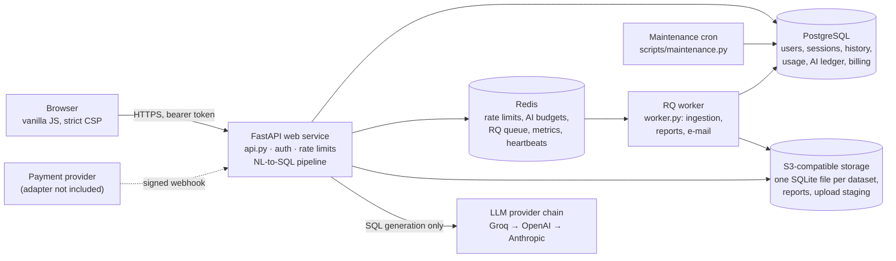

# QuerySure — Architecture

QuerySure turns a plain-English question about a user's own dataset into one validated, read-only SQL query, runs it in a sandbox, checks the result, and records how the answer was produced. **Only one stage calls a language model** (writing SQL). Everything before and after it is deterministic Python that behaves the same on every run and is covered by unit tests.

Related: [Product](01_PRODUCT.md) · [Evaluation](03_EVALUATION.md) · [API reference](API.md) · [Environment variables](ENVIRONMENT.md) · [Operations and deployment](OPERATIONS.md)

## System architecture

One FastAPI process serves both the JSON API and the static frontend (`static/`) from the same origin. Slow work runs on an RQ worker. Without `REDIS_URL` (local development), jobs run inline and limits are kept in process memory; production refuses to start without Redis.

## End-to-end NL-to-SQL workflow

```mermaid
flowchart LR
    Q([Question]) --> G["1 Ground<br/>TF-IDF table retrieval,<br/>value matching"]
    G --> P["2 Plan<br/>rule-based"]
    P --> L{{"3 Generate SQL<br/>LLM, JSON reply"}}
    L --> V["4 Validate<br/>sqlglot AST +<br/>SQLite compile check"]
    V -- "fails: repair, max 2 rounds" --> L
    V --> X["5 Execute<br/>read-only sandbox"]
    X --> R["6 Verify<br/>plan check, independent<br/>reference query"]
    R --> A["7 Answer<br/>rule-based sentence,<br/>chart, reliability score"]
    A --> H["8 Record<br/>history, report job"]
```

| # | Stage | What happens | Code | LLM |
|---|---|---|---|---|
| 1 | Ground | Profile tables and columns, including long-format statistics tables (hierarchy levels and alternative versions that must never be added together, detected from the data: `modules/long_format.py`); TF-IDF retrieval picks relevant tables; words in the question are matched against real stored values (`"completed"` → `'Completed'`) | `modules/schema_engine.py`, `retrieval_engine.py`, `value_grounding.py`, `semantic_layer.py` | No |
| 2 | Plan | Rules extract measure, aggregation, filters, date range, grouping, ordering and limit; on a long-format table, one hierarchy level and one version are fixed from the question ("top-level", "level 2", a named version) | `modules/query_planner.py` | No |
| 3 | Generate | Prompt = schema subset + column profiles + matched values + plan + question, each in nonce-tagged "untrusted data" blocks. Reply must be JSON `{sql, explanation, confidence, complexity}` (Pydantic); invalid JSON is retried once | `modules/sql_generator.py`, `ai_guard.py` | **Yes** |
| 4 | Validate | sqlglot AST: exactly one `SELECT`/`WITH`, only known tables and columns, joins traced through CTEs, no Cartesian joins; must compile in SQLite (`EXPLAIN` on an in-memory schema twin). A specific failure reason goes back to the model, at most 2 repair rounds | `modules/sql_validator.py`, `sqlite_compile_check.py`, `sql_intent_checker.py` | Repair only |
| 5 | Execute | Read-only connection, string literals bound as parameters, 15 s wall clock, 1,000-row cap | `modules/query_result_engine.py`, `sql_params.py` | No |
| 6 | Verify | SQL compared with the plan (including SQL that adds hierarchy levels or versions together, or uses `<>` on a mostly-NULL column); where the plan is unambiguous (single-table), an independent reference query is run and results compared; empty results checked against real values | `modules/result_verifier.py` | No |
| 7 | Answer | Answer sentence, findings and chart built from the returned rows; reliability score capped when not independently verified | `modules/business_insight_agent.py`, `data_reliability_agent.py`, `trust_trace.py` | No |
| 8 | Record | Saved to owner-scoped history (500 entries per user, results capped at 200 rows / 200 KB); report built by a background job | `history_service.py`, `modules/report_generator.py`, `jobs.py` | No |

`POST /api/execute-sql` re-validates the exact SQL it is about to run on every call, so a client cannot skip validation by posting SQL directly.

## Components

| Component | Files | Responsibility |
|---|---|---|
| HTTP API and frontend | `api.py`, `static/` | 53 application routes, same-origin static frontend, security headers, admission control |
| Pipeline | `modules/` | Ingestion, profiling, retrieval, planning, generation, validation, execution, verification, answer |
| Configuration | `config.py` | The only module that reads environment variables; production start-up guards |
| Accounts | `auth.py`, `account_service.py`, `email_provider.py` | bcrypt, JWT bound to revocable sessions, e-mail verification and reset, optional Google sign-in, export and deletion |
| Plans, quotas, AI guard | `entitlements.py`, `quotas.py`, `ai_guard.py` | Daily question limits, storage quotas, AI budgets, circuit breakers, kill switch |
| Background jobs | `jobs.py`, `worker.py` | RQ jobs for ingestion, reports and e-mail; inline when Redis is absent |
| Storage | `storage.py`, `report_storage.py` | Local disk (development) or S3; per-user key prefixes checked on every access |
| Billing | `payment_provider.py`, `billing_service.py` | Provider-neutral adapter boundary and idempotent webhook engine ([BILLING.md](BILLING.md)) |
| Operations | `observability/`, `ops_api.py`, `scripts/` | Structured logs, metrics, SLOs, alerts, 8 aggregate-only admin routes, backup and maintenance scripts |
| Evaluation | `evaluation/` | 62-case benchmark harness (see [03_EVALUATION.md](03_EVALUATION.md)) |

## Data flow

1. **Upload.** `POST /api/connect/upload` streams the file to disk with a per-type size limit (CSV/JSON 50 MB, Excel 50 MB, SQLite 100 MB), checks the user's quota, stages it (S3 in production) and returns `202` with a job ID.
2. **Ingestion.** The worker converts CSV, JSON or Excel into one SQLite file (row, column, sheet and zip-bomb caps), profiles it, and stores it under the user's prefix. The bundled sample (`create_retail.py`) is a deterministic 5-table retail database.
3. **Question.** The pipeline above reads the dataset through a local read-only copy (`storage.ensure_local`). The LLM receives schema context and the question; it never receives full data rows.
4. **Result.** Rows, SQL, validation and trace are stored on the user's `pipeline_sessions` row and in `query_history`; the browser renders them with escaped output.

## Database

PostgreSQL in production (SQLite allowed only outside production), managed by **15 Alembic migrations**; CI runs `alembic upgrade head` and `alembic check` against Postgres 16.

| Area | Tables |
|---|---|
| Identity | `users`, `auth_sessions`, `email_verification_tokens`, `password_reset_tokens` |
| Product | `pipeline_sessions`, `query_history`, `reports`, `jobs` |
| Usage and AI | `usage_daily`, `ai_invocations` (provider, model, tokens, cost, latency; no prompts or keys) |
| Billing | `subscriptions`, `checkout_sessions`, `billing_events` (idempotency ledger), `payments` |
| Operations | `ops_events`, `ops_incidents` |

User datasets are not stored in Postgres: each is a separate SQLite file in object storage, opened read-only per query.

## APIs

53 application routes plus 8 admin routes. The complete list, kept in sync with the code by `tests/test_sprint5_docs.py`, is in [API.md](API.md).

| Group | Main routes |
|---|---|
| Auth | `POST /api/auth/register`, `verify-email`, `login`, `forgot-password`, `reset-password`, `google`, `sign-out`, `logout-all`; `GET /api/auth/me` |
| Data | `POST /api/session`, `/api/connect/sample`, `/api/connect/upload`; `GET /api/jobs/{job_id}`, `/api/dataset/preview` |
| Pipeline | `POST /api/retrieve-tables`, `generate-sql`, `validate-sql`, `execute-sql`, `analyze-reliability`, `generate-insights`, `generate-report`; `GET /api/answer-trace` |
| History and account | `GET /api/history`, `GET/DELETE /api/history/{entry_id}`, `POST /api/history/clear`, `GET /api/account/export`, `POST /api/account/delete` |
| Plans and billing | `GET /api/usage`, `GET /api/billing`, `POST /api/billing/checkout`, `POST /api/billing/webhook/{provider_name}` |
| Health and ops | `GET /api/health` (liveness), `GET /api/ready` (database + Redis), `/api/admin/ops/*` (admin allow-list, aggregates only) |

## AI layer

| Concern | Implementation |
|---|---|
| Provider chain | Order from `LLM_PROVIDER_ORDER` (default `groq,openai,anthropic`); providers without a key are skipped. Defaults: Groq `openai/gpt-oss-120b` → `openai/gpt-oss-20b` (`reasoning_effort=low`), OpenAI `gpt-4o-mini`, Anthropic `claude-haiku-4-5-20251001`. Every model ID is an environment variable |
| Limits | 25 s per provider call, 60 s per question, at most 8 provider calls per question; per-provider circuit breaker opens after 5 failures for 30 s (process-local state) |
| Cost control | Per-user daily budget (`DAILY_LLM_BUDGET_USD`, default $2.00, scaled by plan) and a global daily cap (`GLOBAL_DAILY_AI_BUDGET_USD`, default $25), reserved **before** each call atomically in Redis, with a database ledger fallback; fails closed; `AI_KILL_SWITCH` |
| Prompt injection | User-derived text is cleaned, length-capped and wrapped in nonce-tagged data blocks; the validator and read-only sandbox remain the real gate |
| Browser API keys | A client-supplied API key is accepted only outside production |

## Security controls

| Risk | Control | Evidence |
|---|---|---|
| Destructive or exfiltrating SQL | Four layers: AST allow-list → read-only connection (`mode=ro`, `PRAGMA query_only`) → deny-by-default SQLite authorizer (no `ATTACH`, `PRAGMA`, `sqlite_*` tables, `load_extension`) → 15 s / 1,000 rows / 1 MB per value | `tests/test_execution_guardrails.py`, `test_v105_sqlite_validator.py`, `test_sprint3_prompt_injection.py` |
| Cross-tenant access | Every session, dataset, job, report and history row is owner-checked; another user's IDs return 404; storage keys checked against the user prefix | `tests/test_isolation.py`, `test_sprint2_jobs.py`, `test_sprint3_reports.py` |
| Account takeover | bcrypt; password rules; per-IP rate limits (login 5/min, register 3/min, forgot-password 3/hour); per-account login back-off; JWT bound to a revocable server-side session; reset and verification tokens stored as hashes, single use, expiring | `tests/test_auth.py`, `test_sprint5_auth_account.py` |
| XSS | Escaped rendering (jsdom tests run the real `static/js/app.js`), strict CSP with no inline scripts, `X-Frame-Options: DENY`, `nosniff`, `Referrer-Policy: no-referrer`, HSTS in production | `tests/test_xss_escaping.py` (needs Node) |
| Hostile uploads | Size limits, zip-bomb ratio, row/column/sheet caps | `tests/test_sprint2_ingestion_limits.py` |
| Runaway AI cost | Budgets reserved before every call, global cap, kill switch | `tests/test_sprint3_ai_protection.py`, `test_final_budget.py` |
| Unsafe production config | Refuses to start without: a JWT secret of at least 16 characters, PostgreSQL, Redis, S3, SMTP, HTTPS `APP_BASE_URL`, explicit `TRUSTED_PROXY_IPS`, explicit CORS origins | `config.py`, `tests/test_sprint5_docs.py`, `test_sprint1_hardening.py` |
| Logs leaking user data | JSON logs with PII scrubbing; route templates only; user IDs as keyed hashes; no prompts, SQL or result rows | `tests/test_sprint4_logging.py` |
| Admin overreach | Admin routes return aggregates only and import no user-content model | `tests/test_sprint4_ops_privacy.py` |

**Known security gaps:** the bearer token is stored in `localStorage` (mitigated by CSP and escaping, not eliminated); registering an existing e-mail returns `409`, which reveals that the account exists; no MFA; uploaded SQLite files are opened without `PRAGMA trusted_schema=OFF`; there is no security.txt or disclosure programme.

### Data, privacy and account deletion

| Data | Where | Visible to |
|---|---|---|
| Account (e-mail, bcrypt hash, plan) | PostgreSQL | The user; operators with database access |
| Uploaded datasets, reports | Object storage | The owning user only through the app |
| Questions, SQL, results | PostgreSQL | The owning user; admins see aggregates only |
| AI call metadata | `ai_invocations` | Tokens, cost, model and latency; no prompts |

The LLM provider receives schema context and the user's question. `GET /api/account/export` returns the user's account, usage, sessions and metadata (no password or token hashes, no dataset contents). `POST /api/account/delete` requires a fresh credential and fails closed: it refuses while jobs are running or a paid subscription is live, deletes stored objects first, and deletes database rows only if every object deletion succeeded. Payment and billing-event rows are kept de-identified. Log lines (keyed hashes only) and backups age out under the operator's retention policy; `scripts/reapply_deletions.py` re-applies deletions after a restore.

## Deployment

| Target | What it provides | Status |
|---|---|---|
| Local, no Docker | `python start.py`: creates `.env`, generates a JWT secret, builds the sample database, serves on port 5000 with SQLite and inline jobs; e-mails written to `.dev_mail/` | Local mode used for the reported SQLite test run |
| Docker Compose (development) | `docker-compose.yml`: PostgreSQL 16 (volume `querysure_pgdata`), Redis 7, API on host port **5001**, RQ worker with a Redis-heartbeat healthcheck | `docker compose config` validates; **not started in this review** |
| Docker image | `Dockerfile`: multi-stage, Python 3.12.8 slim, non-root UID 10001, `alembic upgrade head` before start in production, `HEALTHCHECK` on `/api/health` | Built in CI (`.github/workflows/ci.yml`); not built in this review |
| Render | `render.yaml`: web (runs migrations then uvicorn), worker (Starter), 30-minute maintenance cron (Starter), PostgreSQL, Key Value (`noeviction`, private) | Blueprint parses; **not deployed in this review** |

The `render.yaml` blueprint uses free plans for the web service, database and Key Value store. Free Postgres expires after 30 days, free Key Value is not persistent, and the free web service sleeps when idle; these must be upgraded before real users. Step-by-step deployment, smoke tests, backup and recovery are in [OPERATIONS.md](OPERATIONS.md#9-deployment).
