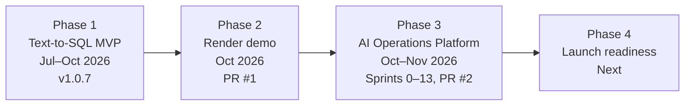

# Roadmap

How QuerySure got here, and what comes next. Dates come from the Git history and the repository. Milestone detail is in [03_MILESTONES.md](03_MILESTONES.md).

## Delivered

| Phase | Goal | Outcome | Evidence |
|---|---|---|---|
| **1. Text-to-SQL MVP** (2026-07-01 → 2026-10-23) | Plain-English questions over uploaded files, with answers users can check | v1.0.7: 8-stage pipeline, read-only sandbox, independent verification, accounts, plans, background jobs, observability. 7 sprints plus release fixes | [SPRINT_HISTORY.md](../SPRINT_HISTORY.md) Sprints 1–7, [CHANGELOG.md](../../CHANGELOG.md) v1.0.7 |
| **2. Public demo** (2026-10-25 → 2026-10-27) | Run on a free host without a worker or paid e-mail | Render free demo mode, e-mail over HTTPS, CI smoke tests fixed | PR #1, merged 2026-10-27 |
| **3. AI Operations Platform** (→ 2026-11-18) | Turn a single-user tool into a team platform | Workspaces and roles, connectors, data quality, knowledge hub, assistant, controlled agent, investigations, evaluation and governance, launch tooling, redesigned UI | Sprints 0–13; PR #2, merged 2026-11-18 |

## Next

Ordered by value to a first real user, then risk. Item IDs refer to the [product backlog](04_PRODUCT_BACKLOG.md).

| Horizon | Theme | Items | Why now |
|---|---|---|---|
| **Now** | Make the demo reliable | B-04 paid database and Key Value plan (free PostgreSQL expires after 30 days; it expired once already), B-12 own e-mail domain, B-13 S3 storage | A demo that resets every month or sends mail to spam loses users before they try it |
| **Now** | Prove quality with a live model | B-01 full live evaluation on a paid quota, B-08 recalibrate "Low confidence" on live results | The one success metric still below target is live accuracy |
| **Next** | Close the biggest accuracy gaps | B-09 match non-English words to data values, B-06 clarifying questions, B-10 two-table verification | These are the main causes of wrong answers found in the live runs |
| **Next** | Security hardening | B-07 token in an HttpOnly cookie, `trusted_schema=OFF` for uploaded SQLite | Known limitations listed in the evaluation |
| **Later** | Commercial | B-03 real payment adapter, MFA | Only needed once there are paying users |
| **Later** | Retrieval | B-11 revisit embeddings if live misses trace back to reworded questions | The decision rule says not yet |

## How priorities were set

1. **Safety and data loss first** (P0): nothing ships that can write data, leak another team's data or run up an unbounded AI bill.
2. **Evidence before features:** a feature is done only with a test that proves its acceptance criteria.
3. **Measure, then decide:** for example, the vector-database decision was made with a rule written before the numbers came in.
